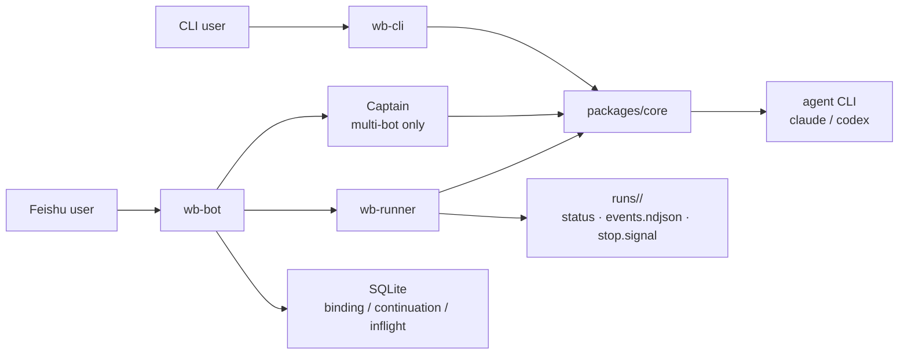
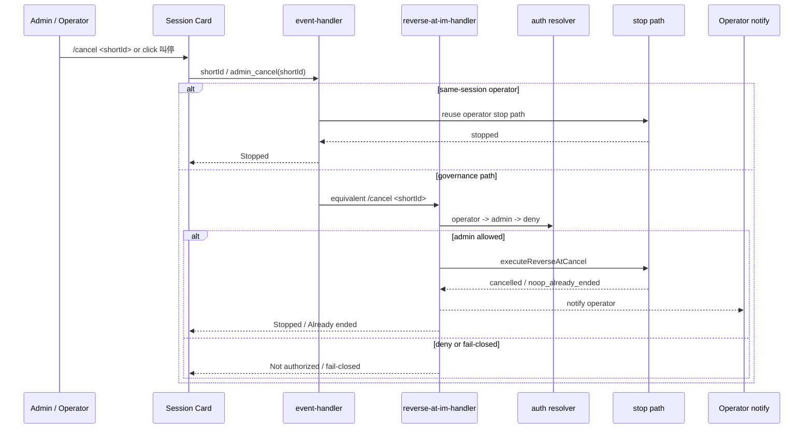
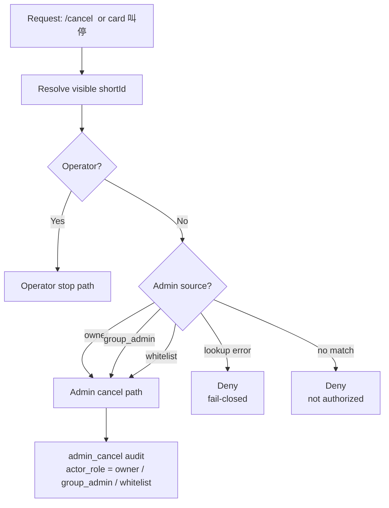

# Weaverbird

> English · [中文](README.md)

[](#quick-start)
[](#quick-start)
[](#commands--permissions-matrix)
[](#governance-flows)
[](#commands--permissions-matrix)
[](#config)

> **Weaverbird** is a single-host Feishu (Lark) AI agent console. You can drive local `claude` / `codex` from Feishu, use a single bot for everyday work, or run multi-bot + Captain mode for cross-bot control, reverse-@ governance, and card-based stop-loss actions.
>
> It is the author's own **personal tool**, not a general-purpose SDK or framework. This README only describes **current implemented behavior**. `passport role` is still a **NO-GO**, `takeover` is still **out of scope**, and real IM / real group / card-button end-to-end validation is still **pending manual verification**.

---

<a id="table-of-contents"></a>
## 📚 Table of Contents

- [⚡ 30-Second Overview](#30-second-overview)
- [🚀 Quick Start](#quick-start)
- [✅ First-run Verification](#first-run-verification)
- [🧭 Commands & Permissions Matrix](#commands--permissions-matrix)
- [⚙️ Config](#config)
- [🏗️ Architecture at a Glance](#architecture-at-a-glance)
- [🛑 Governance Flows](#governance-flows)
- [🧯 Troubleshooting](#troubleshooting)
- [❓ FAQ](#faq)
- [📖 Deep Dives](#deep-dives)
- [🔐 Security & Non-goals](#security--non-goals)

---

<a id="30-second-overview"></a>
## ⚡ 30-Second Overview

### What this is

- Run local agent CLIs such as `claude` and `codex` from Feishu
- Support both **single-bot** and **multi-bot + Captain** as current main paths
- Ship **reverse-@ admin cancel** (`/cancel <shortId>`) and the card `叫停` (`Call Stop`) GUI entry
- Keep all stop-loss governance centered on **explicit shortId**, **fail-closed auth**, and **strong auditability**

### What it can do today

- Run local agents from `@bot` and render results as streaming cards
- Use `/stop` / `/stop-all` for control-plane stop actions
- In Captain mode, use `/cancel <shortId>` or the card `叫停` button on the same admin-governance path
- In multi-bot mode, use `/list-bots`, `/status`, and `/health` for cross-bot visibility

### What it does NOT already have

- `passport role`: **NO-GO** (see W10)
- `takeover`: **out of scope**
- Real IM / real group role / real card-button end-to-end validation: **pending manual verification**

---

<a id="quick-start"></a>
## 🚀 Quick Start

> **Recommended path**: if you already have a Feishu self-built app `LARK_APP_ID` / `LARK_APP_SECRET`, the 5 steps below are the shortest success path.  
> **No Feishu credentials yet?** Use `wb-cli` for a local smoke test first; only go to [`apps/wb-bot/README.md`](apps/wb-bot/README.md) when you need to set up the Feishu app.

### 5-step quick start

1. **Install dependencies**

   ```bash
   npm install
   ```

2. **Copy the template**

   ```bash
   cp apps/wb-bot/.env.example apps/wb-bot/.env
   ```

3. **Fill only the minimum config**

   ```dotenv
   LARK_APP_ID=your_lark_app_id_here
   LARK_APP_SECRET=your_lark_app_secret_here
   LARK_ENCRYPT_KEY=
   LARK_VERIFICATION_TOKEN=
   ```

4. **Start the bot**

   ```bash
   npm run wb-bot:dev
   ```

5. **Verify in Feishu**

   - DM or mention the bot with `@bot /help`
   - Then send `/list-agents`
   - If you get an agent capability card back, the path is working

### 30-second local smoke without Feishu credentials

```bash
npm run dev -- list-agents
npm run dev -- run "hello"
```

This only verifies that local `claude` / `codex` commands can run. It does not validate Feishu integration.

### Which guide should I open next?

- First single-bot setup: [`apps/wb-bot/README.md`](apps/wb-bot/README.md)
- Multi-bot / Captain: [`docs/guides/multi-bot-setup.md`](docs/guides/multi-bot-setup.md)
- Captain sessions / CLI binding: [`docs/guides/captain-setup.md`](docs/guides/captain-setup.md)
- Reverse channel / `wb-cli attach` / SLA: [`docs/guides/reverse-channel-setup.md`](docs/guides/reverse-channel-setup.md)
- Run history / `/wb resume --inherit`: [`docs/guides/run-registry-setup.md`](docs/guides/run-registry-setup.md)
- Audit-pipe supervision: [`docs/guides/audit-pipe-setup.md`](docs/guides/audit-pipe-setup.md)

### When should you go directly to multi-bot?

Go straight to [`docs/guides/multi-bot-setup.md`](docs/guides/multi-bot-setup.md) if any of these are true:

- You want `@claude` and `@codex` in the same chat
- You need Captain `/list-bots`, `/status`, `/health`, or `/stop-all`
- You need the full reverse-@ admin cancel + card `叫停` governance surface

---

<a id="first-run-verification"></a>
## ✅ First-run Verification

For a first successful run, focus on these 4 signals:

| Success signal | What you should see |
|---|---|
| Dependency install succeeds | `npm install` completes without dependency errors |
| Startup succeeds | `npm run wb-bot:dev` stays up and does not report missing Lark config |
| Command surface is ready | `/help` and `/list-agents` respond in Feishu |
| Card path is ready | A normal request returns an updatable running card |

If you are already on the Captain path, also confirm:

- `/status` shows per-bot summary lines
- `/health` shows control-plane health details
- the running card shows a visible `#shortId`

---

<a id="commands--permissions-matrix"></a>
## 🧭 Commands & Permissions Matrix

> This section only documents **currently implemented** command surfaces. Hidden commands, future-state ideas, and research-only behavior are intentionally excluded.

| Entry | Surface | Explicit target | Current gate | Best use |
|---|---|---|---|---|
| `/stop` | Control-plane entry for the current bot / current thread | Current active session (or active runs in the current thread) | **Control-plane path**, not W8 admin governance | Stop your own current task |
| `/stop-all` | Single-bot or Captain control plane | Single-bot: current bot; Captain: all active runs across bots | **Control-plane path**, not `admin_cancel` | Emergency sweep / unified stop |
| `/cancel <shortId>` | Reverse-@ governance entry | **Visible shortId** | `operator -> admin(owner/group_admin/whitelist) -> deny`; role lookup failure is `fail-closed` | Governed stop-loss on someone else's run |
| Card `Stop` | Running card | Current card's session | **Operator/self-stop path** | Stop your own current task from the card |
| Card `叫停` | Running card | **shortId already shown on the card** | Exactly the same path as `/cancel <shortId>`; **visibility != authorization** | One-click stop-loss on someone else's run |

### Operator vs Admin

| Role | `/stop` | `/stop-all` | `/cancel <shortId>` | Card `叫停` |
|---|---:|---:|---:|---:|
| operator | ✅ main path | ✅ control-plane path | ⛔ does not enter `admin_cancel`; falls back to operator stop path | ✅ but short-circuits back to operator stop path |
| admin (`owner / group_admin / whitelist`) | ➖ not part of the W8 governance entry | ➖ not part of the W8 governance entry | ✅ governed stop-loss | ✅ same path as `/cancel <shortId>` |
| ordinary member / non-member | ➖ depends on control-plane context | ➖ depends on control-plane context | ❌ deny | ❌ deny |

### Three governance facts to remember

1. **Visibility != authorization**: seeing the `叫停` button does not mean the request will be allowed.
2. **shortId is the only explicit target**: no “stop the latest active task” guessing.
3. **operator does not enter `admin_cancel` audit**: for operators, card `叫停` is only a GUI shortcut to the existing stop path.

---

<a id="config"></a>
## ⚙️ Config

> **Rules first**: this README only explains the key variables that matter for first success and governance safety. Advanced provider / wrapper / debug variables are documented in [`apps/wb-bot/.env.example`](apps/wb-bot/.env.example).  
> All example values must remain **placeholders**. Do not put real secrets, real open_ids, or real allowlists in docs.

### First-run config table

| Variable | Required | Safe default | If wrong, you'll see |
|---|---|---|---|
| `LARK_APP_ID` | yes | no default | the bot cannot start or connect to Lark |
| `LARK_APP_SECRET` | yes | no default | the bot cannot start or connect to Lark |
| `LARK_ENCRYPT_KEY` | only if enabled in Lark | empty | callback validation fails if Feishu-side encryption is enabled but this is missing |
| `LARK_VERIFICATION_TOKEN` | only if enabled in Lark | empty | same as above |
| `WB_DATA_DIR` | no | `~/.weaverbird` | runtime data lands in an unexpected location, or multiple environments mix together |
| `WB_DEFAULT_CWD` | no | empty | first message without explicit `/cwd` may be rejected as disallowed cwd |
| `WB_REVERSE_AT_ADMIN_OPEN_IDS` | no | **empty = empty set = no extra admin grant** | a wrong value may grant admin authority to the wrong people |
| `WB_CLAUDE_COMMAND` | only if you use a wrapper | `claude` | `claude` is unavailable, wrapper hangs, or model selection behaves unexpectedly |
| `WB_CODEX_COMMAND` | only if you use a wrapper | `codex` | `codex` is unavailable or wrapper args do not match |
| `WB_CLAUDE_CONSENT_LEVEL` | no | `auto` | no-TTY behavior differs from your interactive local CLI expectation |

### Key security defaults

- `WB_REVERSE_AT_ADMIN_OPEN_IDS=` left empty means **no automatic privilege expansion**.
- Reverse-@ admin lookup is always **fail-closed**: role lookup failure means deny.
- All keys / tokens / app secrets in `.env.example` must remain placeholders.

### Where to look for advanced options

These are still supported, but you should usually only touch them after the basic path is working:

- `ANTHROPIC_API_KEY`
- `OPENAI_API_KEY`
- `ANTHROPIC_BASE_URL`
- `OPENAI_BASE_URL`
- `LOG_LEVEL`
- `WB_CLAUDE_APPEND_SYSTEM_PROMPT`

Authoritative inline comments: [`apps/wb-bot/.env.example`](apps/wb-bot/.env.example)

---

<a id="architecture-at-a-glance"></a>
## 🏗️ Architecture at a Glance



This diagram only represents the **current mainline implementation**:

- `wb-bot` and `wb-cli` are the two current entry points
- `Captain` only exists in multi-bot mode
- `wb-runner` is responsible for detached execution and `stop.signal`
- run state lives in SQLite and `runs/<botId>/<runId>/`

---

<a id="governance-flows"></a>
## 🛑 Governance Flows

### Reverse-@ cancel sequence



### Authorization short-circuit



### What is intentionally NOT on this governance path

- `passport role`: **NO-GO** (W10 research)
- `takeover`: **out of scope**
- implicit “stop the latest active run” targets: **out of scope**

---

<a id="troubleshooting"></a>
## 🧯 Troubleshooting

| Symptom / Error | Likely cause | What to do |
|---|---|---|
| `npm run wb-bot:dev` starts but Feishu never responds | the Feishu app is not using long connection mode, did not subscribe to `im.message.receive_v1` / `card.action.trigger`, or is missing required scopes | go back to [`apps/wb-bot/README.md`](apps/wb-bot/README.md) and verify the Feishu setup step by step |
| `claude: command not found` / `codex: command not found` | the local CLI is not installed, or the wrapper command name is wrong | first confirm `claude --version` / `codex --version`; if you use a wrapper, check `WB_CLAUDE_COMMAND` / `WB_CODEX_COMMAND` |
| you do not know where to start and suspect multiple components are failing together | the control plane now splits health into WSClient / SQLite / disk / audit-pipe / Run Registry / Captain Sessions / Captain Queue / Reverse Channel | run `/health` first, then branch into [`docs/guides/audit-pipe-setup.md`](docs/guides/audit-pipe-setup.md), [`docs/guides/run-registry-setup.md`](docs/guides/run-registry-setup.md), [`docs/guides/captain-setup.md`](docs/guides/captain-setup.md), or [`docs/guides/reverse-channel-setup.md`](docs/guides/reverse-channel-setup.md) based on the failing line |
| `/cancel <shortId>` or card `叫停` says the target cannot be found | the shortId is stale, the card is old, or the run already ended | re-check the `#shortId` shown on the running card; do not guess the latest active task |
| clicking `叫停` returns not authorized | you are neither the operator nor `owner / group_admin / whitelist`; or group-role lookup failed | confirm the current group role first; if lookup failed, the system denies by **fail-closed** |
| the running card does not show `叫停` | you are not on the matching governance surface, the session is not running, or the card has no shortId | first confirm this is a running session card, then confirm you are on a supported governance path |
| `strict` consent does not behave like your local CLI | `wb-bot` is a no-TTY backend process and will not show an interactive permission UI | use the no-TTY backend semantics described in this README, not the interactive local CLI mental model |
| multi-bot discovery returns 0 or `BOT_ID mismatch` | `.env.<botId>` filename and `BOT_ID=` inside do not match, or the file is in the wrong directory | see [`docs/guides/multi-bot-setup.md`](docs/guides/multi-bot-setup.md) for naming and directory rules |

---

<a id="faq"></a>
## ❓ FAQ

### Should I start with single-bot or multi-bot?

- If you only want the shortest path to first success: **single-bot**
- If you need Captain, `/stop-all`, cross-bot visibility, reverse-@ admin cancel, or card `叫停`: **multi-bot**

### What is the difference between `/stop` and `/cancel <shortId>`?

- `/stop`: the control-plane stop path for the current bot / current context  
- `/cancel <shortId>`: the W8/W11 **admin-governed stop-loss path**, which requires an explicit shortId, fail-closed auth, and auditability

### Why doesn't card `叫停` always work just because I can see it?

Because **visibility != authorization**. The button is only a GUI entry. Clicking it still goes through the same W8 auth chain: `operator -> admin -> deny`.

### Why does this README explicitly say `passport role` is a NO-GO?

Because the W10 conclusion is already closed: it is not a drop-in replacement for the current W8/W11 chat-governance authority source.

### Is `takeover` supported?

No. Current admin authority is limited to stop-loss, not becoming a second operator.

### Has card `叫停` been validated end to end in real Feishu yet?

This README only promises **implemented code / test-surface behavior**. Real IM / real group-role / real card-button end-to-end validation is still treated as **pending manual verification**.

---

<a id="deep-dives"></a>
## 📖 Deep Dives

### Open these first (new users / operators)

- Single-bot shortest path: [`apps/wb-bot/README.md`](apps/wb-bot/README.md)
- Multi-bot deployment: [`docs/guides/multi-bot-setup.md`](docs/guides/multi-bot-setup.md)
- Captain sessions / CLI binding: [`docs/guides/captain-setup.md`](docs/guides/captain-setup.md)
- Reverse channel / `wb-cli attach` / SLA: [`docs/guides/reverse-channel-setup.md`](docs/guides/reverse-channel-setup.md)
- Run registry / history / inherit-resume: [`docs/guides/run-registry-setup.md`](docs/guides/run-registry-setup.md)
- Audit-pipe launchctl supervision: [`docs/guides/audit-pipe-setup.md`](docs/guides/audit-pipe-setup.md)
  - key file: `scripts/com.weaverbird.audit-pipe.plist.template`
  - key outputs: `logs/_audit-pipe`, `audit-mirror.ndjson`
  - common check: `launchctl list | grep weaverbird`
- Local hourly review mechanism: [`docs/guides/hourly-review-system.md`](docs/guides/hourly-review-system.md)

### Then these (governance / architecture)

- Product boundary: [`docs/product-strategy.md`](docs/product-strategy.md)
- Current mainline abstraction: [`docs/topics/agent-adapter.md`](docs/topics/agent-adapter.md)

---

<a id="security--non-goals"></a>
## 🔐 Security & Non-goals

### Security defaults

- All `.env` / `.env.example` values in docs must remain **placeholders**
- `WB_REVERSE_AT_ADMIN_OPEN_IDS=` left empty is the safe default; it does not auto-grant admin authority
- Reverse-@ group-role lookup is always **fail-closed** on lookup failure
- Do not put real tokens, real open_ids, or real allowlists into README / `.env.example` / `CHANGELOG.md`

### Non-goals

- `passport role` as the authority source: **NO-GO**
- `takeover`: **out of scope**
- implicit “stop the latest active task” targets: **out of scope**
- turning Weaverbird into an external SDK / framework: **out of scope**
- claiming real IM / real group / real button E2E as completed: **out of scope**
