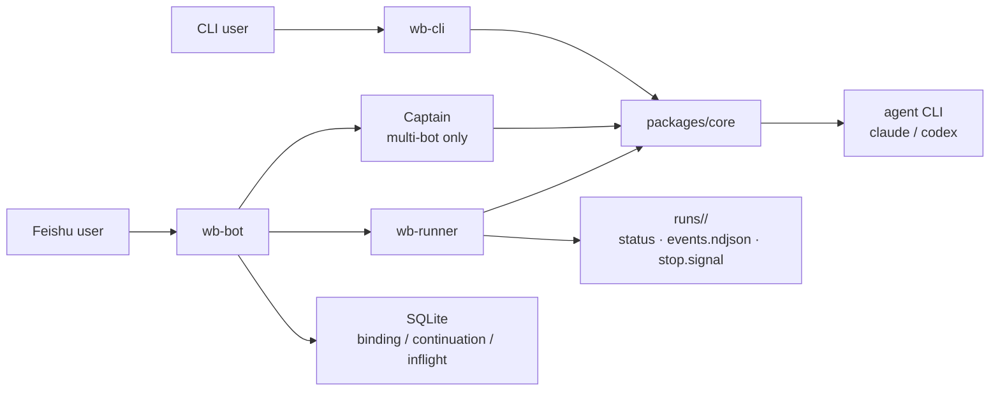
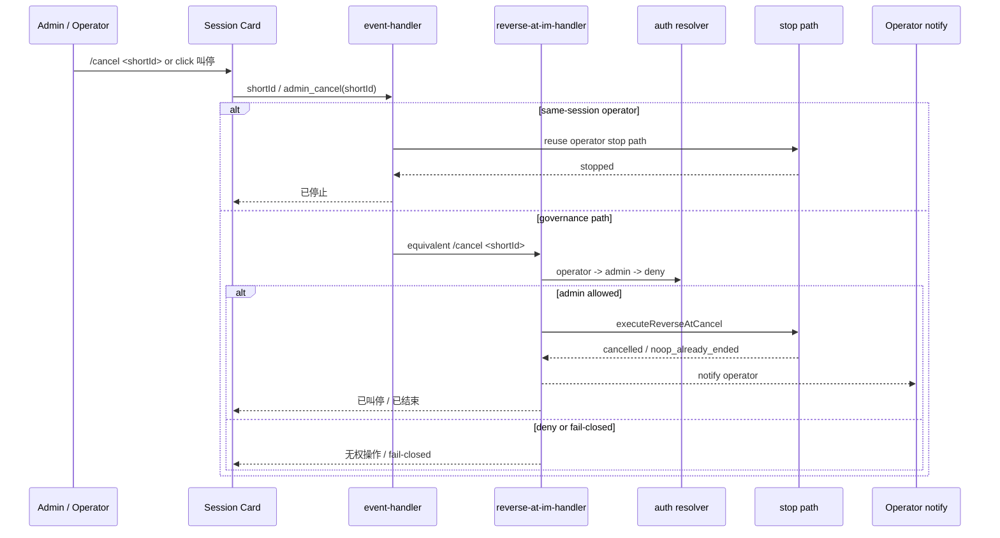
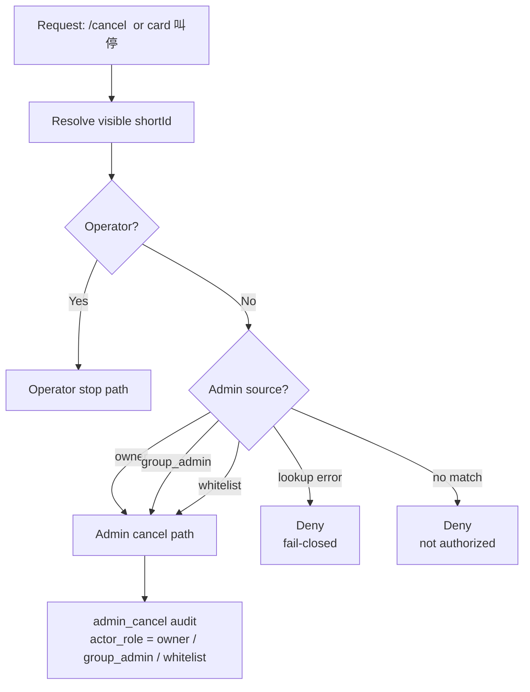

# Weaverbird

> 中文 · [English](README.en.md)

[](#quick-start)
[](#quick-start)
[](#commands--permissions-matrix)
[](#governance-flows)
[](#commands--permissions-matrix)
[](#config)

> **Weaverbird** 是一个单机部署的飞书（Lark）AI agent 操控台：你可以在飞书里驱动本机 `claude` / `codex`，用单 bot 跑通日常任务，也可以在多 bot + Captain 模式下做跨 bot 控制、reverse-@ 治理和卡片式止损。
>
> 它是作者自己的 **个人工具**，不是通用 SDK / framework。README 只描述 **当前已落地行为**；`passport role` 仍是 **NO-GO**，`takeover` 仍 **不做**，真实 IM / 真群 / 卡片按钮端到端仍是 **手工待验**。

---

<a id="table-of-contents"></a>
## 📚 Table of Contents

- [⚡ 30-Second Overview](#30-second-overview)
- [🚀 Quick Start](#quick-start)
- [✅ First-run Verification](#first-run-verification)
- [🧭 Commands & Permissions Matrix](#commands--permissions-matrix)
- [⚙️ Config](#config)
- [🏗️ Architecture at a Glance](#architecture-at-a-glance)
- [🛑 Governance Flows](#governance-flows)
- [🧯 Troubleshooting](#troubleshooting)
- [❓ FAQ](#faq)
- [📖 Deep Dives](#deep-dives)
- [🔐 Security & Non-goals](#security--non-goals)

---

<a id="30-second-overview"></a>
## ⚡ 30-Second Overview

### 这是什么

- 在飞书里调用本机 `claude` / `codex` 等 agent CLI
- 支持 **single-bot** 和 **multi-bot + Captain** 两种主路径
- 已落地 **reverse-@ admin cancel**（文本 `/cancel <shortId>`）与 **卡片 `叫停` GUI 入口**
- 所有治理止损都围绕 **显式 shortId**、**fail-closed**、**强审计** 设计

### 今天已经能做什么

- `@bot` 跑本机 agent，并用流式卡片回显结果
- 用 `/stop` / `/stop-all` 做控制面止停
- 在 Captain 启用时，用 `/cancel <shortId>` 或卡片 `叫停` 走同一条 admin 治理链
- 在多 bot 模式下用 `/list-bots`、`/status`、`/health` 看跨 bot 状态

### 不要误解成已经有的能力

- `passport role`：**NO-GO**（见 W10）
- `takeover`：**不做**
- 真机 IM / 真群角色 / 卡片按钮端到端：**手工待验**

---

<a id="quick-start"></a>
## 🚀 Quick Start

> **推荐路径**：如果你已经有飞书自建应用的 `LARK_APP_ID` / `LARK_APP_SECRET`，下面 5 步就是最短成功路径。  
> **还没有飞书凭证？** 先用 `wb-cli` 做本机 smoke；要补飞书配置时，再看 [`apps/wb-bot/README.md`](apps/wb-bot/README.md)。

### 5-step quick start

1. **安装依赖**

   ```bash
   npm install
   ```

2. **复制模板**

   ```bash
   cp apps/wb-bot/.env.example apps/wb-bot/.env
   ```

3. **只填最小配置**

   ```dotenv
   LARK_APP_ID=your_lark_app_id_here
   LARK_APP_SECRET=your_lark_app_secret_here
   LARK_ENCRYPT_KEY=
   LARK_VERIFICATION_TOKEN=
   ```

4. **启动 bot**

   ```bash
   npm run wb-bot:dev
   ```

5. **在飞书里验证**

   - DM 或群里 `@bot /help`
   - 再发 `/list-agents`
   - 看到卡片返回 agent 能力摘要，就算跑通

### 没有飞书凭证时的 30 秒本机 smoke

```bash
npm run dev -- list-agents
npm run dev -- run "hello"
```

这条路径只验证本机 `claude` / `codex` 命令能否跑通，不验证飞书集成。

### 常用入口怎么选

- single-bot 首次落地：[`apps/wb-bot/README.md`](apps/wb-bot/README.md)
- multi-bot / Captain：[`docs/guides/multi-bot-setup.md`](docs/guides/multi-bot-setup.md)
- Captain sessions / CLI 绑定：[`docs/guides/captain-setup.md`](docs/guides/captain-setup.md)
- reverse channel / `wb-cli attach` / SLA：[`docs/guides/reverse-channel-setup.md`](docs/guides/reverse-channel-setup.md)
- run history / `/wb resume --inherit`：[`docs/guides/run-registry-setup.md`](docs/guides/run-registry-setup.md)
- audit-pipe 托管：[`docs/guides/audit-pipe-setup.md`](docs/guides/audit-pipe-setup.md)
- Calendar Hook / F14 真机验证：[`docs/guides/w3.5-calendar-f14-real-device-runbook.md`](docs/guides/w3.5-calendar-f14-real-device-runbook.md)

### 什么时候该直接走多 bot

满足任一项时，直接看 [`docs/guides/multi-bot-setup.md`](docs/guides/multi-bot-setup.md)：

- 想在同一群里同时 `@claude` / `@codex`
- 需要 Captain 的 `/list-bots` / `/status` / `/health` / `/stop-all`
- 需要 reverse-@ admin cancel 与卡片 `叫停` 的完整治理面

---

<a id="first-run-verification"></a>
## ✅ First-run Verification

首次成功建议只看这 4 个信号：

| 成功信号 | 你应该看到什么 |
|---|---|
| 依赖安装成功 | `npm install` 无依赖错误 |
| 启动成功 | `npm run wb-bot:dev` 进程不退出、无 Lark 配置报错 |
| 命令面就绪 | 飞书里 `/help`、`/list-agents` 有返回 |
| 卡片链路就绪 | 发一条普通请求后，收到可更新的运行卡片 |

如果你已经在 Captain 路径上，还可以额外确认：

- `/status` 有 per-bot 摘要
- `/health` 能看到控制面健康信息
- running card 顶部有可见 `#shortId`

---

<a id="commands--permissions-matrix"></a>
## 🧭 Commands & Permissions Matrix

> 这一节只写 **当前已落地** 的命令面。隐藏命令、未来态、研究态能力不在这里宣传。

| Entry | Surface | Explicit target | Current gate | Best use |
|---|---|---|---|---|
| `/stop` | 当前 bot / 当前 thread 的控制面入口 | 当前活跃 session（或当前 thread 内活跃 runs） | **控制面路径**，不是 W8 admin governance | 自己停止当前任务 |
| `/stop-all` | single-bot 或 Captain 控制面 | single-bot：当前 bot；Captain：跨 bot 所有 active runs | **控制面路径**，不是 `admin_cancel` | 紧急 sweep / 统一停机 |
| `/cancel <shortId>` | reverse-@ 治理入口 | **可见 shortId** | `operator -> admin(owner/group_admin/whitelist) -> deny`，role lookup 失败 `fail-closed` | 对别人的运行做受限治理止损 |
| 卡片 `停止` | 运行卡片 | 当前卡片对应 session | **operator/self-stop 路径** | 自己从卡片停止当前任务 |
| 卡片 `叫停` | 运行卡片 | **当前卡片已显示的 shortId** | 与 `/cancel <shortId>` **完全同链路**；**可见性 ≠ 授权** | 对别人的运行做一键止损 |

### Operator vs Admin

| 角色 | `/stop` | `/stop-all` | `/cancel <shortId>` | 卡片 `叫停` |
|---|---:|---:|---:|---:|
| operator | ✅ 主路径 | ✅ 控制面路径 | ⛔ 不进入 `admin_cancel`，回到 operator 既有路径 | ✅ 但会短路回 operator stop path |
| admin (`owner / group_admin / whitelist`) | ➖ 不属于 W8 治理入口 | ➖ 不属于 W8 治理入口 | ✅ 受限治理止损 | ✅ 与 `/cancel <shortId>` 同链 |
| 普通成员 / 非成员 | ➖ 视控制面上下文 | ➖ 视控制面上下文 | ❌ deny | ❌ deny |

### 三个必须记住的治理事实

1. **可见性 ≠ 授权**：就算你看到了卡片 `叫停`，点击后依然会走 W8 授权判定。  
2. **shortId 是唯一显式目标**：不做“停最近一次”“停最新活跃”这种隐式猜测。  
3. **operator 不进入 `admin_cancel` audit**：卡片 `叫停` 对 operator 只是 GUI shortcut，不会扩展审计枚举。  

---

<a id="config"></a>
## ⚙️ Config

> **规则先说清**：README 只解释首次成功率与治理安全相关的关键变量；更高级的 provider / wrapper / debug 项，以 [`apps/wb-bot/.env.example`](apps/wb-bot/.env.example) 注释为准。  
> 所有示例值都必须是 **占位符**，不要填真实 secret、真实 open_id、真实白名单。

### First-run 配置表

| Variable | Required | Safe default | If wrong, you’ll see |
|---|---|---|---|
| `LARK_APP_ID` | yes | 无默认值 | bot 无法启动或无法连接 Lark |
| `LARK_APP_SECRET` | yes | 无默认值 | bot 无法启动或无法连接 Lark |
| `LARK_ENCRYPT_KEY` | only if enabled in Lark | 留空 | 若飞书侧开启消息加密但这里没配，回调验证失败 |
| `LARK_VERIFICATION_TOKEN` | only if enabled in Lark | 留空 | 同上 |
| `WB_DATA_DIR` | no | `~/.weaverbird` | 运行数据落点不符合预期，或多个环境混用 |
| `WB_DEFAULT_CWD` | no | 留空 | 首次消息无 `/cwd` 时可能提示 cwd 不允许 |
| `WB_REVERSE_AT_ADMIN_OPEN_IDS` | no | **留空 = 空集 = 保持现行行为** | 误填会把不该放权的人加入 admin 白名单 |
| `WB_CLAUDE_COMMAND` | only if you use a wrapper | `claude` | `claude` 命令不可用、wrapper 挂死、模型选择异常 |
| `WB_CODEX_COMMAND` | only if you use a wrapper | `codex` | `codex` 命令不可用或 wrapper 参数错位 |
| `WB_CLAUDE_CONSENT_LEVEL` | no | `auto` | 在 no-TTY 环境下行为与你本地 CLI 交互不一致 |

### 关键安全默认值

- `WB_REVERSE_AT_ADMIN_OPEN_IDS=` 留空时，**不会自动扩权**。  
- reverse-@ 管理链一律走 **fail-closed**：群角色查询失败就拒绝。  
- `.env.example` 中所有 key / token / app secret 都必须保持占位符。  

### 其他高级项去哪看

以下变量依然支持，但建议在你**已经跑通**之后再看：

- `ANTHROPIC_API_KEY`
- `OPENAI_API_KEY`
- `ANTHROPIC_BASE_URL`
- `OPENAI_BASE_URL`
- `LOG_LEVEL`
- `WB_CLAUDE_APPEND_SYSTEM_PROMPT`

权威注释：[`apps/wb-bot/.env.example`](apps/wb-bot/.env.example)

---

<a id="architecture-at-a-glance"></a>
## 🏗️ Architecture at a Glance



这个图只表示 **当前主线实现态**：
- `wb-bot` / `wb-cli` 是两个入口
- `Captain` 只在 multi-bot 下启用
- `wb-runner` 负责 detached 运行与 `stop.signal`
- 运行状态落在 SQLite 和 `runs/<botId>/<runId>/`

---

<a id="governance-flows"></a>
## 🛑 Governance Flows

### reverse-@ cancel sequence



### authorization short-circuit



### 当前不在这条治理链里的东西

- `passport role`：**NO-GO**（W10 research）
- `takeover`：**不做**
- “停最新活跃”隐式目标：**不做**

---

<a id="troubleshooting"></a>
## 🧯 Troubleshooting

| Symptom / Error | Likely cause | What to do |
|---|---|---|
| `npm run wb-bot:dev` 启动后飞书完全没响应 | 飞书应用没开长连接、没订阅 `im.message.receive_v1` / `card.action.trigger`、或缺 scope | 回到 [`apps/wb-bot/README.md`](apps/wb-bot/README.md) 的飞书 6 步配置逐项核对 |
| `claude: command not found` / `codex: command not found` | 本机 CLI 没装，或 wrapper 命令名写错 | 先在终端确认 `claude --version` / `codex --version`；如用 wrapper，再检查 `WB_CLAUDE_COMMAND` / `WB_CODEX_COMMAND` |
| 不知道该先查哪里、怀疑多组件一起异常 | 当前控制面已经把健康检查拆成 WSClient / SQLite / disk / audit-pipe / Run Registry / Captain Sessions / Captain Queue / Reverse Channel | 先执行 `/health`，再按结果分别看 [`docs/guides/audit-pipe-setup.md`](docs/guides/audit-pipe-setup.md)、[`docs/guides/run-registry-setup.md`](docs/guides/run-registry-setup.md)、[`docs/guides/captain-setup.md`](docs/guides/captain-setup.md)、[`docs/guides/reverse-channel-setup.md`](docs/guides/reverse-channel-setup.md) |
| `/cancel <shortId>` 或卡片 `叫停` 提示找不到目标 | shortId 已失效、卡片过期、目标 run 已结束 | 重新看 running card 顶部的 `#shortId`；不要猜最新活跃任务 |
| 点击 `叫停` 但显示无权操作 | 你不是 operator，也不是 `owner / group_admin / whitelist`；或群角色查询失败 | 先确认当前群角色；若角色查询失败，系统按 **fail-closed** 拒绝 |
| running card 上没有 `叫停` | 当前不在对应治理面、session 未处于 running、或当前卡片不带 shortId | 先确认这是 running session card；再确认你是在支持该治理面的路径上 |
| `strict` 的 consent 行为和本机 CLI 不一样 | `wb-bot` 是 no-TTY 后端进程，不会弹交互式 permission UI | README 中的 consent 说明以后端 no-TTY 语义为准，不按交互式 CLI 心智理解 |
| multi-bot discovery 为 0 或 `BOT_ID mismatch` | `.env.<botId>` 文件名与 `BOT_ID=` 不一致，或文件放错目录 | 看 [`docs/guides/multi-bot-setup.md`](docs/guides/multi-bot-setup.md) 的命名规则与目录结构 |

---

<a id="faq"></a>
## ❓ FAQ

### 我第一次上手，应该先用 single-bot 还是 multi-bot？

- 只想先跑通：**single-bot**
- 需要 Captain、`/stop-all`、跨 bot 状态、reverse-@ admin cancel、卡片 `叫停`：**multi-bot**

### `/stop` 和 `/cancel <shortId>` 有什么区别？

- `/stop`：当前控制面 / 当前 bot 的 stop 路径  
- `/cancel <shortId>`：W8/W11 的 **admin 治理止损路径**，要求显式 shortId、fail-closed、强审计

### 为什么卡片 `叫停` 不是看到就一定能点通？

因为 **可见性 ≠ 授权**。按钮只是 GUI 入口，点击后依旧会走 W8 的授权链：`operator -> admin -> deny`。

### 为什么 README 明确写 `passport role` 是 NO-GO？

因为 W10 研究已经关结论：它不是当前 W8/W11 chat-governance authority source 的 drop-in 替代品。

### `takeover` 支持吗？

不支持。当前 admin 仅有受限止损权，不是第二个 operator。

### 卡片 `叫停` 已经做过真实飞书端到端验证了吗？

README 只承诺 **代码 / 测试层面的已落地行为**。真实 IM / 真群角色 / 真卡片按钮端到端仍按当前策略保留为 **手工待验**。

---

<a id="deep-dives"></a>
## 📖 Deep Dives

### 先看这些（面向新用户 / 运维）

- 单 bot 最短启动：[`apps/wb-bot/README.md`](apps/wb-bot/README.md)
- 多 bot 部署：[`docs/guides/multi-bot-setup.md`](docs/guides/multi-bot-setup.md)
- Captain sessions / CLI 绑定：[`docs/guides/captain-setup.md`](docs/guides/captain-setup.md)
- reverse channel / `wb-cli attach` / SLA：[`docs/guides/reverse-channel-setup.md`](docs/guides/reverse-channel-setup.md)
- run registry / history / inherit-resume：[`docs/guides/run-registry-setup.md`](docs/guides/run-registry-setup.md)
- audit-pipe launchctl supervision：[`docs/guides/audit-pipe-setup.md`](docs/guides/audit-pipe-setup.md)
  - 关键文件：`scripts/com.weaverbird.audit-pipe.plist.template`
  - 关键落点：`logs/_audit-pipe`、`audit-mirror.ndjson`
  - 常用检查：`launchctl list | grep weaverbird`
- Calendar Hook / F14 真机验证：[`docs/guides/w3.5-calendar-f14-real-device-runbook.md`](docs/guides/w3.5-calendar-f14-real-device-runbook.md)
- hourly review 本地机制：[`docs/guides/hourly-review-system.md`](docs/guides/hourly-review-system.md)

### 再看这些（面向治理与架构）

- 产品边界：[`docs/product-strategy.md`](docs/product-strategy.md)
- 当前主线抽象：[`docs/topics/agent-adapter.md`](docs/topics/agent-adapter.md)

---

<a id="security--non-goals"></a>
## 🔐 Security & Non-goals

### Security defaults

- 所有 `.env` / `.env.example` 示例值必须保持 **占位符**
- `WB_REVERSE_AT_ADMIN_OPEN_IDS=` 留空是安全默认，不自动扩权
- reverse-@ 群角色查询失败一律 **fail-closed**
- 不在 README / `.env.example` / `CHANGELOG.md` 中写真实 token、真实 open_id、真实白名单

### Non-goals

- `passport role` authority source：**NO-GO**
- `takeover`：**不做**
- 隐式“停最新活跃”目标：**不做**
- 把 Weaverbird 写成对外 SDK / framework：**不做**
- 把真实 IM / 真群 / 真按钮 e2e 写成已完成：**不做**

## 许可

MIT，见 [LICENSE](LICENSE)。
