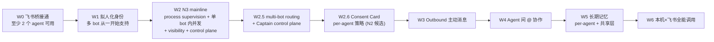

# Weaverbird 产品策略 (v0.2)

> APIAgent 相关叙事已于 W3 撤回,见 docs/product-strategy-APIAgent-deprecation-note.md

> **版本**: v0.2  
> **状态**: spec  
> **创建**: 2026-05-24  
> **性质**: 策略文档，只描述意图与边界，不描述实现 spec
>
> **不修改范围**: 本文档不修改 `docs/architecture/`、`docs/requirements/`、`docs/guides/`、`docs/testing/`、`README.md`、`packages/`、`apps/`、`reviews/` 任何既有内容。具体实现 spec 由后续独立 plan 承接（见 §11）。

---

## 1. North-star

> **Weaverbird 是个人开发者的飞书操控台，统一编排本机 CLI agent（claude code / codex / cursor-cli）与云端 API agent（mira / openai-compatible），支持独立并行 / 多视角 / 流水线三种多任务形态，权限和成本按 agent 切片，关键决策点用移动端 Consent Card 收敛。同时保证只挂 1 个 agent 的用户体验零降级。**

这一句是后续所有产品决策的判断尺。任何 feature、抽象、文档若不能服务这条 north-star，应当推回 backlog 或拒绝。

### 1.1 边界澄清（what Weaverbird is NOT）

为防止后续 plan 起草时把"内部多 agent 抽象"误读成"对外 kernel"，显式撕清楚：

- ❌ **不是 kernel / SDK / framework**：不向外部消费者提供"基于 Weaverbird 写你自己 agent 工具"的 SDK 合约。
- ❌ **不是 horizontal platform**：不假设有第二个用户在其上构建产品；N≥2 用户的生态不是目标。
- ✅ **是 opinionated 个人工具**：`AgentAdapter` 等抽象服务**作者本人**增删 agent 的工程纪律，不是外部接入面；spec 是内部工程合同，不是公开承诺。

与 `feishu-claude-code-bridge` / `lark-codex-tunnel` 等单 agent 实现的关键差异：内部多 agent 友好（加新 agent ≈ 一个 AgentAdapter 实现，约 200 LOC），但**对外仍是个人工具，不是 framework**。

**`apps/wb-cli` 长期地位**：W0 walking skeleton 产物，W1 后 `apps/wb-bot` 是产品主线，`wb-cli` 不被 `wb-bot` 依赖。当前定位是 `AgentAdapter` 契约的 reference path（作者调试 adapter 时的 stable 入口）；W2-W3 close 时再决策是否 deprecate 或 archive 到 `_legacy/`，详见 `docs/topics/agent-adapter.md` §11.4 第 20 项。

**v4 修订 (W2/W2.5 设计阶段, 2026-05-29)**: 以下 4 条澄清基于 W2/W2.5 spec 起草过程对作者真实使用场景的深度访谈, 锁定后续设计走向:

- **服务对象**: 作者本人, 角色 SRE / 研发兼任. 不专门服务 PM / 运营 — 后者需求 (文档生成 / dashboard / 内部 API 查询) 由 agent 自身能力 + 用户写 SKILL.md 自然覆盖, weaverbird 不上移这些能力.

- **Tier 化产品哲学**: Tier 1 单 bot 极致 (W2 主线) 是所有用户的下限, 企业 / 个人都友好 (单次飞书应用审批 / 开箱即用); Tier 2 多 bot 偏好满足 (W2.5 主线) 是审美 / 故障隔离增量, 不是替代. Tier 1 不依赖 Tier 2; Tier 2 是单 bot 的增量, default bot 升 Captain 而非被替代. 设计契约见 `docs/topics/single-bot-concurrent-agents.md` / `multi-bot-routing.md` / `captain-bot.md` / `process-supervision-bounds.md`.

- **邻居工具关系**: `mira-cli` (未来接入) = 同层 agent CLI (跟 `claude-code` / `codex` 同级), 通过 `CLISubprocessAgent` 接入 (写 1 个 `MiraAgent` adapter), **不是 MCP server, 不是中间层**. `claude-code` Skills / Dynamic Workflows = agent 自身能力, 用户在 `~/.claude/skills/` 自管, weaverbird 透传不集成. `lark-cli` / 内部 API = 各 agent 自己通过 MCP / shell / 内置工具调用, weaverbird 不做内部 API 上移.

- **用户驱动交互原则**: 任何 agent → agent / bot → bot 信息流动必须有显式用户行为触发 (复制粘贴 / forward 按钮 / `SKILL.md` 触发 pipeline / dynamic workflow 关键词). 绝不允许 weaverbird 自动跨 agent 调度 / agent 自动转发 (M3 红线). 详见 W2 topic spec §10 边界声明.

- **多 IM channel 抽象永远不做**: weaverbird 单一飞书是 D' 边界的故意选择. 不引入类 agentara 的 `MultiChannelMessageGateway` 抽象层. 未来若需要 Slack/Discord 等其它 IM 平台, 接受重写代价, 不预先抽象 (避免 W0 D-strong 漂移). 这条与 §1.2 "不预埋未来能力字段" 同源.

#### 1.1.E · 7 项目谱系定位 (W2 设计阶段横向对照)

W2 设计阶段对照 7 个邻居 / 同类项目 (按抽象层次升序):

| 项目 | 用户群体 | 多 agent | 多 IM | 自管能力 | 代表能力 | 抽象层次 |
|---|---|---|---|---|---|---|
| `feishu-claude-code-bridge` | 个人 | ✗ | ✗ | 无 | 单 claude 飞书 bridge | 1 |
| `feishu-codex-bridge` | 个人 | ✗ | ✗ | 无 | 单 codex 飞书 bridge | 1 |
| `lark-codex-tunnel` | 个人 | ✗ | ✗ | tmux + file IPC | 单 codex Lark tunnel + process supervision | 2 |
| Flux Island (灵动岛) | 个人 | ? | (非 IM) | UI consent | 移动端 consent UI | 2 |
| **weaverbird (W2/W2.5)** | **作者 SRE (D')** | **✓** | **✗ (W2.5 多 bot identity)** | **少 (process supervision + visibility + control plane)** | **多 agent + 飞书 + supervision** | **3** |
| `happyclaw` | 个人/团队 | claude plugin | (非 IM) | plugin automation + hooks | Claude Code plugin 系统 | 3 |
| `mira-cli` | 自建 | 单 (带工具集) | (CLI) | 自有 API + MCP elicitation | 带工具集的 agent CLI | 4 |
| `agentara` | 任何人 (开放) | ✓ | ✓ (channel 抽象) | 多 (skills/memory/cron/dashboard) | 24/7 personal assistant | 5 |

**weaverbird 卡位**: 中间偏左, 比 `*-bridge` 系列重 (多 agent + supervision 是真需求), 比 `agentara` 轻 35%+ (skills/memory/cron/dashboard/multi-IM 都不上移). 此卡位是 D' 边界的精确兑现 — 服务作者本人 1 用户的最优工程预算.

**应学的工程实践 (不破 D' 边界)**: agentara `boot-loader` 完整性验证 + `AbortController` signal 传递 + 任务 4 状态机 (W2 P1 修订采纳). lark-codex-tunnel file IPC supervision 思路 (W2 Block A 已采纳).

**永远不学的能力上移**: agentara 的 `MultiChannelMessageGateway` / 22 内置 skills / `~/.agentara/memory/` / cron jobs / React Web Dashboard / Drizzle ORM / Bun runtime 切换 (D' 边界).

详细对照见各 spec: `docs/topics/agent-adapter.md` §11.4 (跨产品对照清单), `docs/topics/process-supervision-bounds.md` §2 (与 lark-codex-tunnel 思路对照), `docs/topics/captain-bot.md` §6 (反 framework drift 与 agentara 设计哲学差异).

### 1.2 抽象冻结纪律（防止 D-strong 漂移）

W0 已实现的抽象（`AgentAdapter` / `AgentRun` / `AgentCapabilities` / 10 类 `AgentEvent` / `ToolDescriptor` / `ConsentLevel` / `ErrorCode`）足够支撑 W1–W3。**冻结**以下事项：

- ❌ 不在飞书产品闭环未跑通前继续打磨抽象字段细节
- ❌ 不基于"反正抽象已经这么干净了"继续扩展未来能力字段
- ❌ 不为单一 agent 实例追加 `capabilities` 子结构
- ✅ 任何新抽象必须先回答"是否直接服务飞书多 agent 产品面"，不服务则延后到该抽象有真实使用方时
- ✅ pipeline / fan-out / orchestration 等 W2 多 agent 协作能力出现真实需求时再设计，不预埋

抽象 ROI 已在 W0 落地时验证成立（临界点 N≈2，第 2 个 agent 即回本）；后续工作必须把收益**兑现到产品**，而非继续抽象。本条纪律约束的是 W1 及之后的 plan 起草，不回头改 W0 已有代码。

---

## 2. 产品定位

> **当前主线 vs 战略叙述分层 (W2.5 收口明文 · 2026-06-03)**: 本节 §2.1–§5 描述的 **4 agent / APIAgent / dispatcher / T3 流水线** 是 Weaverbird 的**战略目标**, 不是当前主线兑现态. 当前主线 W2/W2.5 实际兑现:
>
> - **2 个 CLI agent**: `claude-code` · `codex` (走 `CLISubprocessAgent`)
> - **0 个 APIAgent**: `mira` / `cursor-cli` / `APIAgent` 形态均**未实现**, 是 W3+ spec
> - **0 个 dispatcher**: T4 路由 dispatcher 是**未实现**, 是 W3+ spec
> - **0 条流水线**: T3 流水线 / T2 多视角并行 / agent 间 @ 均**未实现**, 是 W3+ / TOPIC-C spec
>
> §2.1–§5 的叙述用现在时是为了让战略目标完整可见, **不代表已实现**. 当前实际能力以 `README.md` Roadmap 与 §6 entry criteria 表为准.

### 2.1 核心定位

**multi-agent 是 Weaverbird 存在的理由**。要对接的 4 个具体 agent 是 codex、claude code、mira (api)、cursor-cli，目标是多任务处理。

### 2.2 产品适应性

**single-agent 用户能用得好，是产品的适应性 / 包容性，不是定位**。即使只挂 1 个 agent，W1–W6 的体验也必须独立成立（W4 天然例外，详见 §9）。

### 2.3 与对手的差异面

| 形态 | 移动可用 | 异步推送 | 跨设备 | 本机算力 | 本机文件/密钥 |
|---|---|---|---|---|---|
| Cursor IDE / 本机 CLI 直跑 | 否 | 否 | 否 | 是 | 是 |
| Claude.ai / ChatGPT Mobile | 是 | 是 | 是 | 否 | 否 |
| Cursor Cloud Agent | 是 | 是 | 是 | 远端容器 | 远端容器 |
| **Weaverbird** | **是** | **是** | **是** | **是** | **是** |

Weaverbird 占据"移动 + 异步 + 跨设备 + 本机算力 + 本机文件"五项全中的位置，是其他形态短期内无法同时覆盖的空格。这是产品的护城河来源。

---

## 3. 对接对象

### 3.1 四类 agent 的形态差异

| Agent | 形态 | runtime 位置 | agent loop 谁实现 |
|---|---|---|---|
| claude code | CLI 子进程 | 本机 | Anthropic（在 CLI 内） |
| codex | CLI 子进程 | 本机 | OpenAI（在 CLI 内） |
| cursor-cli | CLI 子进程 | 本机 | Cursor（在 CLI 内） |
| mira (api) | HTTP 端点 | 本机调用 | **Weaverbird 自己** |

### 3.2 两种 agent 形态

- **CLI-wrapped Agent**：subprocess + stdin/stdout，借用对方已实现的 agent loop（claude code / codex / cursor-cli 走此形态）
- **API-driven Agent**：Weaverbird 自己跑一个轻量 agent loop（消息维护 + 工具调用循环 + memory injection），每步调 LLM API（mira / openai-compatible 走此形态）

### 3.3 主抽象

`AgentAdapter` 是 Weaverbird 的主抽象。其下挂两种实现 `CLISubprocessAgent` 和 `APIAgent`，对上层（飞书 bot / card / pending-queue / memory）暴露统一的 `AgentEvent` 流。

> 具体协议形态由 **TOPIC-B** 承接，本文档不展开。

---

## 4. Agent 能力市场

> **Weaverbird 不是"agent 平等容器"，是"agent 能力市场"。**

### 4.1 不假装平等

每个 agent 自报家门（capabilities 声明），用户可见。不掩盖 mira (api) 与 claude code 在 reasoning / tool use / context window / cost 上的真实差异。

### 4.2 "统一程度"三档

| 档位 | 内容 | 是否可达 |
|---|---|---|
| 档位 1 · 命令统一 | `/agent xxx` 同一命令面板 | 可达 |
| 档位 2 · 流式 UX 统一 | 打字机、工具调用折叠、done 状态机视觉一致 | 可达（需在 `APIAgent` 内做 tool calling 协议映射到 `AgentEvent`） |
| 档位 3 · 能力对等 | 能做的事一样、做得一样好 | **不可达**，强求会引入技术债 |

档位 3 的诚实差异化应当通过 §4.3 的能力声明明示给用户。

### 4.3 dispatcher 路由

T4 路由 dispatcher 基于 capability 声明 + 用户 hint + 简单规则匹配。**不内嵌 LLM 决策**（见红线 B7）。

若用户想要 LLM-driven 路由，应当通过挂一个"调度 agent"实现（用户自己写其 prompt），调度 agent 与其他 agent 平级，**不是 Weaverbird 内置层**。

---

## 5. 多任务处理的四种形态

### T1 · 独立并行

多个独立任务并发交给不同 agent 执行，结果在飞书各自汇总。

例：让 `@codex` 写后端、`@claude` 写前端、`@mira` 做调研，三路并行。

### T2 · 多视角并行

同一个问题同时给多个 agent，得到多版本，用户比对后选取。

例：让 `@codex` 和 `@claude` 同时分析一个 bug，给出两种方案。

### T3 · 流水线

多 agent 链式协作，每个 agent 完成后触发下一个。multi-agent 真正质变形态。

例：`@codex 写` → `@claude review` → `@cursor-cli 跑测试` → 用户拍板上线。

> 协作协议（agent 间消息总线 / 制品传递 / yaml 模板）由 **TOPIC-C** 承接。

### T4 · 路由 dispatcher

用户下一句话"帮我做 X"，Weaverbird 基于 capability + 用户 hint + 规则选 agent。允许用户用模板 (yaml) 固化常用流水线。**不内嵌 LLM 决策**（B7）。

---

## 6. 累积顺序 W0–W6 (Phase 4 C4 sync, 2026-05-30 主设计师 — D.H-1 milestone 重命名)

> **W2 milestone 身份重命名 (Phase 4 C4 sync)**: W2 由 "Consent Card + per-agent 策略" 改 **"N3 mainline (process supervision + 单 bot 内并发 + visibility + control plane)"**, 原 W2 的 Consent Card 内容平移到 W2.6 (`docs/topics/`). 来源: D.H-1 + plan v1 §4.1 entry criteria 修订. plan v1.5 §4.6 strength-following 印证 N3 优先 (Claude Code dynamic workflow 长跑直接驱动 process supervision 需求, Consent Card 是 N2 衔接, 优先级 W2.6).

### 各步 entry criteria

| 步骤 | 算成立的判定 |
|---|---|
| W0 | 飞书 QR 引导 → 至少能挂 2 个 agent → 一条消息能跑到流式卡片回显 |
| W1 | 每个 agent 有独立 bot 账号 / 头像 / 名字 / 人设；`/agents` 能列出 |
| **W2 (N3 mainline, Phase 4 C4 sync)** | (a) wb-bot 重启可恢复 inflight runs 二态卡片 (`process-supervision-bounds.md` v0.2 §3.0 events.ndjson source of truth); (b) 单 thread 内 ≥2 agent 并发不互阻 (`single-bot-concurrent-agents.md` v0.2 §3.1 scope key + §6.1 `/agent <id>` 空格语法); (c) 7 项固定 control plane 命令 (退化版): `/status` / `/list-bots` / `/health` quick_check / `/tasks` 7 日 + negative list (`captain-bot.md` v0.2 §3.1/§3.5/§3.6/§3.7); (d) Claude Code dynamic workflow 30+ min 长跑 tool_progress 心跳 + 卡片折叠 UI (`agent-adapter.md` §11.5 #22 #24 v0.3) |
| ~~W2 (legacy v0)~~ | ~~危险操作前发 Consent Card；支持 per-agent 默认允许集；按钮回调后 agent 秒级续跑~~ → **平移到 W2.6** |
| **W2.5** | multi-bot 形态启用 (per-bot Lark App + per-bot launchd plist) · bot discovery 文件扫描 (`captain-bot.md` v0.2 §3 + §4) · Captain 命令**已兑现**: `/stop-all` 跨 bot · `/list-bots` · `/status` (per-bot 摘要 + active run 计数) · `/health` (4 项); Captain 命令**未兑现 (W2.6+ 候选 · 按实战需求触发再排批次)**: `/logs <botId>` · `/restart <botId>` · `/tasks bot=<id>` (当前 `/logs` `/tasks` 是 single-bot 实现, captain 模式下也是当前 bot 视角, 不接 bot= 参数; `/restart` 暂不存在) |
| **W2.6 (原 W2 Consent Card 平移)** | 危险操作前发 Consent Card; per-agent 默认允许集 (white-list); 按钮回调后 agent 秒级续跑; **N2 偏好学习候选**: 基于历次 Consent 决策落盘逐步把 Consent 频率压低 |
| W3 | agent 可主动发起消息；支持长任务进度推、卡住求助、定时任务（cron） |
| W4 | agent 之间可互相 @；接收 @ 的 agent 把上游 agent 的输出作为输入 |
| W5 | 每个 agent 有独立 memory 目录；存在跨 agent 共享层（项目级 context） |
| W6 | agent 通过 lark-cli 调用飞书 API；通过本机工具集调用 git / docker / kubectl 等 |

### 6.1 Consent contract in wb-bot (no-TTY invariant)

> 新增于 W2.5-Hotfix-batch-C P1-4 (2026-06-03). 来源: 主设计师 R2 review H3 — "consent 语义已经在文档 / core / bot 之间漂移". 本节把这层漂移**明文化为产品规则**, 而不是隐藏在实现里.

**北极星语义** (core `ConsentLevel`, 5 档, 见 `packages/core/src/agent/types.ts`):

| level | 语义 | core/CLI 行为 (`mapConsentLevelToPermissionMode`) |
|---|---|---|
| `plan-only` | 只产 plan, 不执行任何 tool | claude `--permission-mode plan` |
| `strict` | "ask me for everything" — 每次工具调用都问 | claude `--permission-mode default` (依赖底层 CLI permission UI) |
| `normal` | 默认 | claude `--permission-mode default` |
| `relaxed` | 自动接受 file edit | claude `--permission-mode acceptEdits` |
| `auto` | 完全 bypass | claude `--permission-mode bypassPermissions` |

**wb-bot 不可兑现性** (no-TTY invariant):

wb-bot 永远以 backend 进程 `spawn agent CLI`, 无 TTY 无 stdin. 任何 claude / codex 自身的 startup-phase interactive prompt (workspace trust / permission UI / model picker / 每次 tool 调用 ask) 都会 hang 子进程 → 卡片冻在 "running · 00:00 · -".

因此 wb-bot **不能依赖底层 CLI 的 permission UI** 做 consent gating. 这是 IM 自动消费这一形态的物理约束, 不是 implementation choice.

**wb-bot 的兑现策略** (W2.5 mainline):

1. **`plan-only`**: 保留 `--permission-mode plan` 即可. claude 只产 plan, trust 风险 = 0, 无需 skip permissions.
2. **其余 4 档 (`strict` / `normal` / `relaxed` / `auto`)**: 一律附加 `--dangerously-skip-permissions` 短路底层 CLI permission UI. consent gating 由 **wb-bot 自身的上层产品面**承担 (W2.6 Consent Card 路线), 不依赖 claude 自身的 trust/permission UI.
3. **`strict` 别名化**: 在 `bot-env.ts` `normalizeBotConsentLevel` 入口把 `strict` alias 为 `plan-only` — 因为 strict 语义 = "ask me for everything" 在无 TTY 环境无法兑现, 最接近的可兑现等价物是 `plan-only` (功能等价于 wb-bot 能保证的最严模式).

**与 wb-cli 的差异**:

wb-cli (`apps/wb-cli/src/main.ts`) 走 canonical `AgentAdapter.run()`, 直接交给 core CLI mapping, **不附加** `--dangerously-skip-permissions`. 用户在 terminal 自己回答 prompt.

所以 wb-cli 和 wb-bot 在同一 `consentLevel` 下的执行语义是**预期不一致**的, 这是 surface 物理约束差导致的产品规则, 不是 bug.

**W2.6 衔接**:

W2.6 引入 Weaverbird 自己的 Consent Card 时, wb-bot 的 consent gating 会从 "由用户 .env 选一个 level 一刀切" 升级为 "per-agent 默认允许集 + 危险操作前发 Card 等回调". 届时本节会随之更新, 但底层 CLI permission UI 依然不被信任 (no-TTY invariant 不变).

**测试锚**: `tests/wb-bot/bot-env-loader.test.ts` (strict alias 用例) · `tests/wb-bot/build-agent-args.test.ts` (4 档 → claude argv mapping).

---

## 7. 七条红线

| 编号 | 红线 | rationale |
|---|---|---|
| **B1** | 不做多租户 / 不做用户管理 | 一旦做就走向 happyclaw 形态，跨界 |
| **B2** | 飞书是唯一面向用户的 surface | CLI 仅供调试；多 surface 抽象会再次稀释主线 |
| **B3** | 不为 CLI agent 做 prompt engineering / 不实现通用 agent reasoning | 跨界即变 LangChain / CrewAI；API agent 极简 loop 不在此限 |
| **B4** | 模型层 transparent | 不抄 mirage 的 Debate / Prism / Insight 多模型编排 |
| **B5** | 不内嵌业务（项目管理 / 日历 / 知识库 / oncall 调度） | 业务能力交由 agent 用 lark-cli 调，不内嵌 |
| **B6** | 不做全权代理 | 自动化上限是"陪伴 + 监管"，不进入"代理 + 接管" |
| **B7** | 路由 dispatcher 不内嵌 LLM 决策 | Weaverbird 自身不变成 planning agent；LLM 路由若需要由用户挂调度 agent 实现 |

---

## 8. 能力上限（5 维）

| 维度 | 甜区 | 停点（越过即非 Weaverbird 形态） |
|---|---|---|
| Agent 数量 | 4 是基本盘，8 是甜区上限 | 10+：协调成本超出工具范畴，进入编排器产品 |
| 角色专业化 | 5–10 种主流角色 | 50+ 微角色：等于 microservice + DAG 平台 |
| 协作复杂度 | 流水线 + 简单并行 fanout-join | 循环 / 条件分支 / 动态生成新 agent：进入 LangGraph / AutoGen |
| 自主性 | high-trust 自动通过 + low-trust 拍板 | 全权代理 / 自我升级 / 不可逆决策：AGI 路径 |
| 外部连接 | 本机 + 飞书 + 云端模型 API + 跨用户联邦（A++ N4） | 代表用户做不可撤回决策：法律边界 |

---

## 9. 包容性原则 P1–P4

| 编号 | 原则 | rationale |
|---|---|---|
| **P1** | 体验渐进入门 | 首次启动只装 1 个 agent 即可上手；多 agent 是后续 opt-in |
| **P2** | 单 agent 视图下产品不暴露 multi 概念 | `/agents`、dispatcher、agent 间 @ 在只有 1 个 agent 时自动隐藏 |
| **P3** | W1–W6 任一项必须独立于 agent 数量成立 | 单 agent 用户不得因数量被剥夺体验；W4 天然例外 |
| **P4** | 升级路径无缝 | 从 1 到多不需要"迁移到多 agent 模式"动作；原 agent 的拟人化 / 记忆 / Consent 全部继承 |

---

## 10. A++ 候选纵深 N1–N5

N1–N5 是 Weaverbird 的 Agent 2.0 / 3.0 锚点。**当下不承诺、不排期**——但**当下决策应以"是否朝 N-series 演进"为优先级判据**：

- 所有 W-阶段功能 / TOPIC 设计应能在长期路径中**对接 N-series**，不与之冲突的优先实现
- 纯 1.0 改良型功能（与既有"Agent 状态聚合"类产品同质化）在没有 N-series 衔接时**延迟**
- 形态选择以 §12 spec discipline 框架审，但**优先级排序**额外参考 N-series 对齐度

N-series 是远期愿景，但其存在不只为"未来做什么"——更为"今天**不**做什么"提供判据。

| 编号 | 候选纵深 | 一句话 | W-阶段对接状态 (Phase 4 C4 sync) |
|---|---|---|---|
| **N1** | 跨设备 continuum | 手机输入 + 电脑算力 + 飞书回路无缝串联 | **W2 强化** — W1 飞书桥已通, W2 Block C 单 bot 内并发多 agent + 多卡片 SC-13/SC-14 已加强同 thread 内不同 agent 并发认知; 跨主机延伸候选见 plan v1.5 §4.8 (W3+) |
| **N2** | 偏好学习 | 基于历次 Consent 决策落盘，逐步把 Consent 频率压低 | **W2.6 候选** — Consent Card 在 W2.6 启用 (本次重命名后), N2 偏好学习是 W2.6 内嵌路径 |
| **N3** | 长生命周期任务 | cron / 事件 / 等待三类触发器的 long-running agent task | **W2 兑现 (本次 W2 milestone 主轴, Phase 4 C4 sync)** — process supervision + Claude Code dynamic workflow 30+ min 长跑 + tool_progress 心跳 + 二态卡片重启续接, 是 N3 第一个工程兑现 |
| **N4** | 跨用户 agent 联邦 | 你的 agent @ 同事的 agent；前置条件是 W1–W6 + T1–T3 全部稳定 | (远期) 不在 W2/W2.5/W2.6 范围 |
| **N5** | agent-as-OS | 让 agent 反向接入你的飞书（读未读 / 看日历 / 扫待办），主动 surface 你需要做的事 | (远期) 不在 W2/W2.5/W2.6 范围 |

---

## 11. 待讨论话题（后续会议锚点）

下列话题已识别但本草案不展开，作为后续独立 plan 的承接点。

### TOPIC-B · AgentAdapter 统一抽象的具体形态

- **要回答的问题**：`CLISubprocessAgent` 和 `APIAgent` 的统一接口如何最小可行？`AgentEvent` 8 种事件类型够不够覆盖两种形态？interrupt / abort / resume 在两种形态下如何对齐语义？API agent 的工具集如何注入与隔离？
- **触发条件**：开始 W0–W1 实现之前需要先有此协议草案
- **依赖前置**：本文档 §3、§4 已奠定方向
- **设计草案**：[docs/topics/agent-adapter.md](topics/agent-adapter.md)（v0.2-draft）

### TOPIC-C · T3 流水线 + W4 Agent-to-Agent 协议

- **要回答的问题**：agent 之间靠什么消息总线互相 @？输出 / 制品（diff / 报告 / 测试结果）如何在 agent 间传递？流水线 yaml 模板的最小可行形态是什么？流水线中途失败的回退语义？
- **触发条件**：W3 outbound channel 落地之后
- **依赖前置**：本文档 §5 T3、§6 W4 已奠定方向
- **推迟理由**：TOPIC-C 全部子机制（消息总线 / 制品 / 流水线 / 回退 / interrupt）均为 internal mechanism（仅 Weaverbird 自己实现与使用），无外部实现者依赖；区别于 TOPIC-B（external contract，多方实现）。W0–W1 跑通前任何 spec 皆属揣测。本话题挂起，待真实痛点出现后再启。

### TOPIC-D · M5 权限切片 + Consent Card per-agent 策略

- **要回答的问题**：危险操作如何分类与识别？per-agent 默认允许集如何配置与版本化？Consent Card 的 UI / 回调路径如何最小化？高信任自动通过（N2 偏好学习）如何与 Consent 衔接？跨 agent 信任传递（A 让 B 干活）如何处置？
- **触发条件**：W2 落地的同时即需此安全模型
- **依赖前置**：本文档 §3、§4、§7 B6 已奠定方向

---

## 12. 设计话题启动判据（spec discipline）

> 本节是设计纪律小节，目的是让"是否需要为某话题预先 spec"这件事**有判据可查**，而不是每次重新讨论或凭直觉。沉淀于 2026-05-24 的 TOPIC-B / TOPIC-C / TOPIC-D 撕扯讨论。

任何新设计话题（TOPIC-X）启动 spec 前应用以下两条判据：

- **(I) 是否存在外部消费者依赖此契约？**
  外部 = 非 Weaverbird 自身代码（第三方实现者 / 用户配置写作者 / 跨进程协议 / 跨年份的信息缺失状态的作者本人）

- **(II) 是否存在深语义裂缝 + 高 rework 成本？**
  深裂缝 = 两种实现的同一概念实际含义不同（例：TOPIC-B 中 `sessionId` 在 CLI vs API 形态下含义不同）；高 rework = 晚 spec 会级联多处实现重构

**任一通过** → spec-first，进入独立 plan 撰写。
**两条皆不通过** → 默认延迟，无需在 §11 为该话题单独写 deferral rationale。

历史应用（calibration anchor）：

| TOPIC | (I) | (II) | 决策 |
|---|---|---|---|
| **TOPIC-B** AgentAdapter | 弱 | ✅ 强（三大语义裂缝 + 高级联 rework） | spec-first → `topics/agent-adapter.md` v0.2-draft |
| **TOPIC-C** 协作协议 | ❌ | ❌ | 延迟（见 §11 brief 既有 rationale） |
| **TOPIC-D** Consent 矩阵 | ❌ | ❌（policy-as-code，改表代价分钟级） | 延迟，无需逐项 rationale |

本节本身按 (I) 通过——"跨年份的信息缺失状态的作者本人"是真实的外部消费者，对话历史不是可靠 artifact。

---

## 13. 文档元数据

- **版本号**: v0.2 (Phase 4 C4 sync, 2026-05-30 主设计师)
- **状态**: spec (Phase 4 C4 sync — W2 milestone 重命名 N3 mainline + W2.6 Consent Card 平移)
- **创建时间**: 2026-05-24 (v0.1-draft); v0.2 修订 2026-05-30
- **性质声明**: 策略文档，只描述意图与边界，不描述实现 spec
- **不修改范围**: `docs/architecture/`、`docs/requirements/`、`docs/guides/`、`docs/testing/`、`README.md`、`packages/`、`apps/`、`reviews/`
- **修订方式**:
  - **2026-05-30 v0.2 (Phase 4 C4)**: §6 W2 milestone 重命名 "N3 mainline (process supervision + 单 bot 内并发 + visibility + control plane)"; W2.5 multi-bot routing + Captain control plane 节点显式插入; W2.6 (新) Consent Card 节点 (原 W2 内容平移); §6 entry criteria 表 W2 / W2.5 / W2.6 三行明确划分; §10 N-series 状态板加 "W-阶段对接状态" 列 — N1 标 "W2 强化", N2 标 "W2.6 候选", N3 标 "W2 兑现 (本次 W2 milestone 主轴)"; 来源 D.H-1 + plan v1 §4.1 + plan v1.5 §4.6 strength-following.
  - 后续修订: 以独立 plan / PR 形式提交，避免在本文档内做无 plan 直接编辑.
- **不引用范围**: 本文档不引用 `reviews/` 目录内任何文件作为论据
- **关联文档 (Phase 4 C4 sync)**:
  - 平行 spec: `docs/topics/agent-adapter.md` v0.3-draft (Phase 4 C2: §11.4 W2 卡位 "Tier 1 + N3 supervision" 微调; §11.5 + §11.7 v0.3 字段决议); `docs/topics/process-supervision-bounds.md` v0.2 (Phase 4 C1: events.ndjson source of truth + 双层 heartbeat); `docs/topics/single-bot-concurrent-agents.md` v0.2 (Phase 4 C3: `/agent <id>` 空格语法 + 多卡片 SC-13/SC-14 + typed `/stop` 多 active session); `docs/topics/captain-bot.md` v0.2 (Phase 4 C3: W2.5-only header + W2 退化版边界); `docs/topics/multi-bot-routing.md` (W2.5 主线)
  - plan 上游: `plans/w2-mainline.plan.md` v1.5 (W2 = N3 mainline + Tier 1 单 bot 极致 + Process Supervision + Visibility + plan v1.5 §4.6 strength-following)
