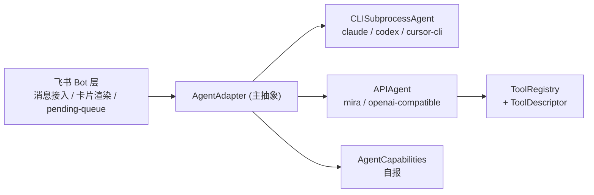

# TOPIC-B · AgentAdapter 统一抽象设计 (v0.3-draft)

> **版本**: v0.3-draft  
> **状态**: spec  
> **创建**: 2026-05-24  
> **性质**: 设计 spec，描述接口形状、行为契约、决策理由，**不描述具体 TypeScript 实现**
>
> **不修改范围**: 本文档不修改 `packages/`、`apps/`、`scripts/`、`reviews/`、`README.md`、`docs/architecture/`、`docs/requirements/`、`docs/guides/`、`docs/testing/` 任何既有内容；仅在 `docs/product-strategy.md` §11 TOPIC-B brief 末尾追加 1 行链接。
>
> **承接关系**: 本文档是 [docs/product-strategy.md](../product-strategy.md) §11 TOPIC-B 的设计草案承接；具体 Consent Card UI 与安全模型由 TOPIC-D 承接；Agent-to-Agent 协议由 TOPIC-C 承接；CLI agent 工具注入由未来 TOPIC-F 承接。

---

## 1. 本文档回答什么 / 不回答什么

### 回答

- `AgentAdapter` 在 Weaverbird 中作为主抽象的接口形状
- `CLISubprocessAgent` 与 `APIAgent` 两种实现各自的语义裂缝
- 10 种 `AgentEvent` 的事件谱
- 6 个开放点（Q1–Q6）的决策与一句理由
- 5 档 `consentLevel` 的统一语义表
- 两类实现各自必须 honor 的行为契约
- 工具集来源的 4 层分层

### 不回答

- 具体 TypeScript / 实现代码 → 由后续实现 plan 承接
- Consent Card 的 UI / 回调路径 / per-agent allowlist 配置细节 → **TOPIC-D**
- agent 之间消息总线 / 流水线 yaml / 制品传递 → **TOPIC-C**
- CLI agent 通过 MCP 注入 Weaverbird 工具的协议 → 未来 **TOPIC-F**
- 与飞书 bot 层的具体绑定（消息接收、卡片渲染） → W0–W1 实现 plan 承接

---

## 2. 三个真实语义裂缝

为什么 CLI agent 与 API agent 不能简单"复用同一份接口就完事"——以下三处是 stress-test 时浮现的真实差异，决定了接口必须如何抽象。

### 裂缝 1 · `sessionId` 含义不同

| 形态 | sessionId 含义 |
|---|---|
| CLI agent | 对方 CLI 自己生成的字符串，`--resume <id>` 续跑；Weaverbird 不解释，opaque 黑盒 |
| API agent | 没有 sessionId 概念；"续跑"等于重发 messages history；token 是 Weaverbird 自己分配的本机 history 引用 |

**决策**：字段统一改名 `sessionId → continuationToken`，语义统一为 opaque token，**由 AgentAdapter 自己生成 / 自己解释，Weaverbird 主流程只存不读**。

### 裂缝 2 · 工具调用的"谁执行"相反

| 形态 | 工具谁执行 |
|---|---|
| CLI agent | 对方 CLI 自己执行；Weaverbird 只是观察者，接收 `tool_use` + `tool_result` 两个事件 |
| API agent | Weaverbird 自己执行：模型 emit `tool_call` → Weaverbird 跑 → 结果以 tool message 追加 messages → 回到 stream |

**关键**：对外暴露的事件序列形状相同（`tool_use` 后跟 `tool_result`），但内部数据流向相反。这是为什么 §4 能力市场必须"诚实差异化"——mira 的工具集 = Weaverbird 给它装的工具集，能力等于 Weaverbird 装备等级，**不等于** claude 的内置工具能力。

### 裂缝 3 · 错误模式 / interrupt 语义

| 行为 | CLI agent | API agent |
|---|---|---|
| stop | SIGTERM → grace → SIGKILL | abort HTTP request（即时） |
| in-flight tool 抢占 | CLI 自处理 | Weaverbird 自处理 |
| crash | exit code ≠ 0 + stderr | HTTP 4xx/5xx / stream 中断 / tool 抛异常 |
| 可重试 | 取决于 CLI | 网络瞬态 / rate limit / 上下文裁剪后 |

**决策**：统一映射到 `{ type: 'error', message, code?, recoverable: bool }`；`code` 用枚举 `auth | rate_limit | context_length | network | tool_failure | crashed`；上层根据 `code + recoverable` 决定飞书卡片渲染（重试按钮 / 重新登陆按钮 / 终止）。

> `interrupt`（区别于 `stop`，"中途改方向保留已生成内容"）**不在 TOPIC-B 范围**——它跟"上游 agent 打断下游 agent"是同一类问题，留给 TOPIC-C。

---

## 3. v0.2 接口结构总览

接口形状以 ASCII tree 描述（不写 TS 代码）。

### 3.1 主体五个 type

```text
AgentAdapter
├─ id              : string
├─ displayName     : string
├─ isAvailable()   : Promise<boolean>
├─ getCapabilities(): Promise<AgentCapabilities>    // async + lazy cache（Q2）
└─ run(req)        : AgentRun

RunRequest
├─ prompt              : string
├─ cwd?                : string                      // 双路使用（Q1）
├─ continuationToken?  : string                      // opaque（裂缝 1）
├─ model?              : string
├─ images?             : string[]                    // 给 vision 模型用（Q3）
├─ attachments?        : string[]                    // 给 file 工具用（Q3）
├─ tools?              : ToolDescriptor[]            // API agent 必传，CLI agent 忽略
├─ consentLevel?       : 'plan-only' | 'strict' | 'normal' | 'relaxed' | 'auto'  // 5 档（Q4）
└─ stopGraceMs?        : number                      // done 后自清的 grace 计时（Q5）

AgentRun
├─ events           : AsyncIterable<AgentEvent>
├─ stop()           : Promise<void>
└─ waitForExit(ms)  : Promise<boolean>

AgentCapabilities
├─ type     : 'cli' | 'api'
├─ input    : { images: boolean, attachments: boolean }
├─ output   : { streaming: boolean, thinking: boolean, toolUse: boolean, citations: boolean }
├─ context  : { window: number, costClass: 'free' | 'cheap' | 'standard' | 'premium' }
├─ skills   : { code: Grade, review: Grade, plan: Grade, research: Grade, ops: Grade }
│             // Grade ∈ 'A+' | 'A' | 'B' | 'C' | 'D'  自报，用户视角
├─ tools    : { builtin: string[], canExtend: boolean }
└─ session  : { resumable: boolean, tokenKind: 'opaque' | 'history-ref' }

ToolDescriptor
├─ id           : string
├─ name         : string
├─ description  : string
├─ inputSchema  : JSONSchema
└─ capabilities :
   ├─ kind   : 'read' | 'write' | 'network' | 'shell' | 'feishu'
   └─ danger : 'safe' | 'caution' | 'destructive'
```

### 3.2 AgentEvent 谱（10 种 discriminated union）

```text
AgentEvent
| type=system            : { continuationToken?: string, cwd?: string, model?: string }
| type=text              : { delta: string }
| type=thinking          : { delta: string }                            // 部分 agent
| type=tool_use          : { id, name, input: unknown }
| type=tool_progress     : { id, message?: string }                     // NEW v0.2
| type=tool_result       : { id, output: string, isError: boolean }
| type=usage             : { inputTokens?, outputTokens?, costUsd? }
| type=consent_required  : { id, operation: ConsentReq }                // NEW v0.2，仅 API
| type=done              : { continuationToken?: string }
| type=error             : { message, code?: ErrorCode, recoverable?: boolean }
```

两个新增事件理由：

- **`tool_progress`**：长任务（`docker build` / `npm install` / 大下载）期间无 text 输出但工具仍在跑；该事件让飞书卡片"还活着"
- **`consent_required`**：Consent Card 触发事件；**仅在 API agent 形态下 emit**，CLI agent 走自己的权限模式不 emit 此事件；具体语义 / UI / 回调由 TOPIC-D 定义

> AgentAdapter 接口允许两种形态 emit 不同子集——上层通过 `capabilities` 知道哪些事件可能出现（例如 `consent_required` 只可能来自 `type: 'api'` 的 agent）。这是**接口稳定 + 行为多态**的健康折中。

### 3.3 ToolRegistry（仅 API 侧使用）

```text
ToolRegistry
├─ register(descriptor, handler)
├─ listForAgent(agentId): ToolDescriptor[]    // 应用 per-agent allowlist（TOPIC-D 定义具体策略）
└─ execute(name, args, ctx): Promise<ToolResult>
```

CLI agent 不读 ToolRegistry——它的工具集由对方 CLI 自带。未来若要给 CLI agent 注入 Weaverbird 工具（如 lark-cli），由 **TOPIC-F**（MCP 桥）承接。

---

## 4. 六个决策 Q1–Q6

| 编号 | 议题 | 选择 | 一句理由 |
|---|---|---|---|
| **Q1** | `cwd` 在 API agent 上是什么角色 | 双路（注入 system + 工具根） | system 让模型知道在哪个项目，工具根让 file 操作有默认根；两者都 zero-cost，CLI agent 内部本身就是这样 |
| **Q2** | `getCapabilities()` 同步还是异步 | 异步 + lazy cache | 构造函数做 IO 是反模式；某些 capability 必须查（model 列表 / `--version`）；缓存解决性能 |
| **Q3** | `images` 与 `attachments` 分还是合 | 分开 + 飞书层按 capabilities 路由 | 语义真实不同（vision vs file）；路由策略归飞书 bot 适配层，接口职责清晰 |
| **Q4** | `permissionMode` 语义统一 | 重命名 `consentLevel`，5 档 | 翻译会模糊；拆两份对用户视角破碎；重命名一刀切语义，接口稳定，两侧各自映射执行机制 |
| **Q5** | `done` 之后 cleanup 谁负责 | AgentAdapter 自清 + `stop()` 仍为 escape hatch | done 后子进程有 telemetry 尾巴，需 grace；HTTP abort 即时无 grace；上层不该感知清理细节 |
| **Q6** | `continuationToken` 是否在 done 必传 | 由 `capabilities.session.resumable` 决定 | 强制不合理（crash 时拿不到）；纯 optional 太松；contract-driven：resumable=true 时正常 done 必须含，crash 允许缺失 |

详细论证留在 plan-mode 对话历史与未来回顾，本文档不重新展开。

---

## 5. 5 档 consentLevel 语义统一表

`consentLevel` 是 Weaverbird 的统一概念——"用户给 agent 多大自主权"。**接口稳定**，两种 agent 形态各自映射到自己的执行机制。

| 档位 | 用户视角描述 | CLI agent 映射 | API agent 映射 |
|---|---|---|---|
| `plan-only` | 只规划不执行 | claude `--permission-mode plan` | system prompt 注入"do not execute"，工具不会被 dispatch |
| `strict` | 任何 write/network/shell 都问 | `default` + 收紧策略 | 凡 capabilities `kind ∈ {write, network, shell}` 全弹 Consent |
| `normal` | 仅 destructive 弹卡（推荐默认） | `default` | 仅 `danger === destructive` 弹 Consent |
| `relaxed` | 信任，仅高危弹卡 | `acceptEdits` | 仅 `danger === destructive` 且涉及 cwd 外 / 生产环境元数据组合时弹 |
| `auto` | 全自动通过 | `bypassPermissions` | 不弹 Consent，仅记录日志 |

**关键**：这一表是 TOPIC-D（Consent 安全模型）的上层接口锚点；TOPIC-D 负责定义"destructive 如何判定 / per-agent allowlist 如何配置 / N2 偏好学习如何自动从 strict 滑到 relaxed"。

---

## 6. `CLISubprocessAgent` 必须 honor 的契约

包 `claude code` / `codex` / `cursor-cli` 等 CLI 形态时必须做到：

- **stream-json 映射**：把 CLI 的 stream-json 输出解析并映射到 10 种 `AgentEvent`
- **sessionId 透传**：CLI 的 sessionId 字符串透传为 `continuationToken`，不做语义解释
- **stop 信号链**：`stop()` 走 SIGTERM → 等 `stopGraceMs` → SIGKILL
- **consentLevel 反向映射**：根据上表把 `consentLevel` 翻译为 CLI 私有的 `--permission-mode` 等参数
- **不 emit `consent_required`**：CLI 自己管 permission，权限决策不暴露给上层
- **error code 推断**：从 stderr 内容、exit code、stdout 末尾推断 `auth | crashed | rate_limit | ...`
- **capabilities 自报**：
  - `type = 'cli'`
  - `session.resumable` 依据 CLI 自身能力声明
  - `input.images` / `output.thinking` 等由具体 agent 决定
- **done 后契约**：emit `done` 后 ≤ `stopGraceMs` 内 `waitForExit()` 必返回 `true`，否则上层会强制终止并 log 警告

---

## 7. `APIAgent` 必须 honor 的契约

包 mira / openai-compatible 等 API 形态时必须做到：

- **自实现 agent loop**：维护 messages history（system / user / assistant / tool）+ 工具调用循环 + memory injection
- **cwd 双路注入**：cwd 同时进 system prompt（让模型知道）和工具 ctx（让 file 工具有默认根）
- **history 持久化**：自维护本机 history 文件；`continuationToken` 是 history 引用，`session.tokenKind = 'history-ref'`
- **stop 即时**：`stop()` 走 `AbortController.abort()` + 清理所有 pending tool calls；`stopGraceMs` 字段忽略
- **consentLevel emit 频率**：根据上表决定何时 emit `consent_required`；只在用户回复"允许"后才继续 tool dispatch
- **tools 来自 RunRequest**：`tools` 数组由上层（基于 ToolRegistry + per-agent allowlist）在 `run()` 时传入；API agent 不直接 import ToolRegistry
- **错误码映射**：HTTP 401 → `auth` / 429 → `rate_limit` / 4xx context too long → `context_length` / 5xx 或网络 → `network` / 工具 throw → `tool_failure` / 内部异常 → `crashed`
- **capabilities 自报**：
  - `type = 'api'`
  - `output.toolUse` 取决于底层模型是否支持 function calling
  - `output.thinking` 取决于底层模型是否暴露 reasoning chain
  - `session.resumable = true`（因 history 在 Weaverbird 本机）

---

## 8. 工具集来源 4 层

API agent 的工具集分层来自以下 4 层。前 3 层进入 ToolRegistry，第 4 层不在 ToolRegistry 中。

| 层 | 内容 | 注册时机 |
|---|---|---|
| **L1 本机基础层** | `file_read` / `file_write` / `glob` / `grep` / `shell_exec` | Weaverbird 启动时 |
| **L2 飞书层** | `lark-cli` 子命令包装（im / drive / calendar / approval / wiki / ...） | Weaverbird 启动时（取决于 `lark-cli` 是否已安装） |
| **L3 用户自定义层** | `~/.weaverbird/tools/*.yaml`（外部脚本 + JSON Schema） | Weaverbird 启动时扫描目录 |
| **L4 agent 自带层** | CLI agent 自己的内置工具（claude 的 Read/Write/Bash/Edit/Glob/Grep/Task/WebSearch 等） | **不进 ToolRegistry**——由 CLI agent 自己管 |

L4 何时能下沉到 L1–L3 共用（即让 CLI agent 也能调 Weaverbird 工具）是未来 **TOPIC-F** 的事，本文档不展开。

---

## 9. 总览图



主抽象唯一。两种实现走各自流程。ToolRegistry 只挂在 API 侧。Capabilities 把两边差异**公开而非掩盖**——这是 §4 能力市场的工程对应。

---

## 10. 承接锚点

下列话题不在本文档范围，但本文档为它们奠定了上层接口：

### TOPIC-D · Consent 安全模型

- 入口：本文档 §5 的 5 档 `consentLevel` 表
- 承接：危险操作分类规则、per-agent allowlist 配置、Consent Card UI 与回调路径、N2 偏好学习如何把 strict 自动滑到 relaxed、跨 agent 信任传递（上游 agent 让下游 agent 干活如何处置）

### TOPIC-C · Agent-to-Agent 协议 + interrupt 语义

- 入口：本文档 §2 裂缝 3 提到的 `interrupt` 不在本文档范围
- 承接：agent 之间消息总线、流水线 yaml 模板、制品（diff / 报告）传递、中途失败回退、interrupt 区别于 stop 的具体协议

### 未来 TOPIC-F · CLI agent 工具注入

- 入口：本文档 §8 L4 层目前不进 ToolRegistry
- 承接：通过 MCP 或类似机制让 lark-cli 等 Weaverbird 内置工具也能给 CLI agent 用；探明 claude / codex / cursor-cli 各自的 MCP 支持度

---

## 11. Open Questions for v0.3

下列问题已识别但 v0.2 阶段不决策，留给未来撕扯。

### 11.1 设计阶段已知问题（v0.2 起草时识别）

1. **`tool_progress` 的最小心跳频率** —— 多久必须 emit 一次才不会让飞书卡片看起来死掉？过于频繁会触发卡片 PATCH rate limit。倾向 2–5s 一次的心跳，但需要与 W2 / W6 飞书层一起验证
2. **`capabilities.session.resumable` 是否需要 enum 化** —— 当前是 `boolean`；如果未来出现 "always-resumable（任何时刻都能 resume）" vs "only-normal-done-resumable（crash 后 token 损坏不能 resume）" 差异，可能需要 `'always' | 'normal' | 'never'`。**不超前抽象**，等真出现 use case 再升级
3. ~~**`thinking` 事件在飞书卡片上的呈现**~~ —— 已定 (feat/feishu-ux-parity)：进行中在过程槽位显示最近约 300 字，结束后收进默认折叠的面板（截 1500 字）；`WB_CARD_SHOW_THINKING=0` 完全隐藏
4. **per-agent ToolRegistry 配置的持久化位置** —— `~/.weaverbird/agents/<id>/tools.yaml` 还是统一 `~/.weaverbird/tools-allowlist.json`？由 TOPIC-D 一起决定

### 11.2 W0 4-视角 review 暴露的 v0.3 候选（W0 实施后追加）

来源：W0 主线 + Batch-A hardening 经过 4 视角独立 review（工程 / Spec+安全 / UX / 战略架构）后暴露的 spec 模糊或语义裂缝。每条标注首发视角与编号（traceability 见 `plans/w0-handoff-notes.md`）。

5. **CLI agent 端 `strict` vs `normal` 语义** —— spec §5 留白"收紧策略"导致 CLI 端实现 `strict ≡ normal`（都映射到 claude `'default'` mode），用户视角完全等价。v0.3 候选两种方案：(a) 显式声明"CLI agent 在缺乏更细粒度 permission mode 时 `strict ≡ normal` 是合法降级"；或 (b) 在 `AgentCapabilities` 中暴露 `permissionGranularity: 'coarse' | 'fine'` 字段，供 dispatcher 决策（三视角确认: 工程 / Spec / UX）
6. **`ErrorCode.tool_failure` 的产生路径** —— 当前 union 中定义但 W0 实现无任何路径会产生它。v0.3 应明确：(a) Reserved for W1+ API agent / post-tool-call validation 路径；或 (b) 收紧为 CLI agent 不可能 emit，仅在 API agent shape 中保留
7. **`done.continuationToken` 与 `system.continuationToken` 的一致性约束** —— Q6 规定 done 必含 token，但未规定与初始 `system` event 携带的 token 是否必须同值。claude-code 实施侧两处都给 `session_id`，通常一致但 spec 无强约束。v0.3 候选：(a) "resumable=true 时 `done.token === 最后一次 system.token`"；或 (b) "允许 `done.token` 为最新值，`system.token` 视为 capability 通告"
8. **`RunRequest.images` / `attachments` / `tools` 在 CLI 形态下的 silent drop 策略** —— `images` / `attachments` 已接通（2026-11，飞书附件落盘后传本地路径）：`CodexAgent` 把 `images` 转成 `--image <path>`，`ClaudeCodeAgent` 把 prompt 里没出现的路径追加为 `附件: <path>` 行，由 claude 用 Read 工具读取；`codex` 的 `attachments` 只出现在 prompt 正文里。`tools` 仍被忽略。spec 应明确处理策略：silent drop / warn / throw 三选一；并明确"caller 传字段但 capability 标不支持"时的行为
9. **D2 done criteria wording（mixed coverage）** —— 实施反馈 F-1 已确认。v0.3 应将 D2 改为 mixed coverage 措辞：runtime fixture 覆盖 emitted events + type/contract 覆盖 non-emitted union members（`consent_required` / `tool_progress` 在 CLI 形态下永不 emit，靠类型守卫与类型测试覆盖）
10. **`RunRequest.stopGraceMs` 默认值** —— 当前实施硬编码 500ms（`cli-subprocess.ts`），spec 未规定。v0.3 应明确 default = 500ms 或允许 adapter 自选
11. **`stopGraceMs` / `waitForExit(timeoutMs)` 的 process-shaped wording 对 API agent 的语义** —— 字段名带 SIGTERM-style lifecycle 假设，对 API agent (`AbortController.abort`) 不自然。v0.3 文档应明确"API agent 视为 no-op / optional hint，不表示一定存在 graceful stop"；或考虑重命名为 transport-agnostic 名称
12. **Platform support 边界** —— W0 实施已用 `node:fs` PATH scan 解决 Windows / Unix 差异，但 spec 未声明 platform support 范围。v0.3 应显式标 platform: macOS / Linux / Windows，并约束 adapter 实现的最小 platform 兼容义务（双视角确认: 工程 / Spec）

### 11.3 §1.2 抽象冻结纪律相关字段（v0.3 文档动作）

按 `docs/product-strategy.md` §1.2 抽象冻结纪律，以下字段在 v0.3 spec 中应有**显式 frozen 注释**（不删不改，不再细化），与代码层 JSDoc 同步：

13. `ToolDescriptor`（§3）
14. `AgentEvent.consent_required` variant（§3）
15. `AgentEvent.tool_progress` variant（§3）
16. `AgentCapabilities.skills`（§3）
17. `AgentCapabilities.tools`（§3）
18. `AgentCapabilities.context.costClass`（§3）

冻结理由：W0 完成后 4-视角 review（特别是战略架构视角）一致建议——这些字段属"未来能力先埋进 union，W0 完全无活实现"，继续打磨会让代码气质偏 D-strong，与 `product-strategy.md` §1.1 D' 定位漂移。

### 11.4 跨产品对照暴露的 v0.3 候选（W1 close 后追加，W2 设计阶段扩充）

来源：W1 mainline + 4 视角 close review 后，主设计师跨参照项目做横向 sanity check 暴露的 spec 缺口。这一类缺口**只有在 IM transport 形态 + 多 agent 组合**下才出现，单 agent + 单 transport 的参照项目都用 wrapper / sandbox / pre-set 规避了，4 视角 review 各自从工程/spec/UX/战略单一视角看不出。

**参照项目清单 (W2 阶段扩充, 7 项目)**:

| 项目 | 形态 | 对 v0.3 的启示 |
|---|---|---|
| `lark-codex-tunnel` | 单 codex Lark tunnel + tmux supervision | process supervision 思路 (W2 Block A 已采纳; **W2 卡位**: Tier 1 单 bot 极致 + N3 mainline supervision, Phase 4 C4 sync — D.H-1 milestone 重命名后 W2 主轴) |
| Flux Island (灵动岛) | 移动端 consent UI | 卡片 STOP 三态思路 (W1 已采纳) |
| `feishu-claude-code-bridge` | 单 claude 飞书 bridge | transport 形态对照 |
| `feishu-codex-bridge` | 单 codex 飞书 bridge | transport 形态对照 |
| `happyclaw` (W2 加) | Claude Code plugin + `~/.claude/settings.json` hooks | PreToolUse hook 桥接 consent (W3+ #PIVOT-1 候选) + plugin 系统对 F0 schema 调研影响 (新增 #31) |
| `mira-cli` (W2 加) | 带工具集的 agent CLI + MCP elicitation | 同层 agent CLI (作为 `MiraAgent extends CLISubprocessAgent`); 不是 MCP server (§1.1 v4 已澄清) |
| `agentara` (W2 加) | 24/7 personal assistant (MagicCube), Bun + Hono + Drizzle + bunqueue + React | 同 niche 但反方向 (上移多 / 抽象高), 跨产品对照后启示见 #32-#34 |

19. **CLI agent consent → IM consent 桥接缺口**（🔴 W1 真跑偏，**W2 必修**） —— claude-code / codex CLI 内部有自己的 consent 机制（跑 shell / 写文件时在 CLI tty 弹 "Allow? (y/n)"）。W1 飞书 transport 形态下，用户发完 prompt 就走开了，CLI 弹的 prompt 无人 approve → agent 在飞书里"看似 stuck"。当前 W1 实施侧 `ClaudeCodeAgent` / `CodexAgent` 都没把 CLI tty consent 桥成 `AgentEvent.consent_required`；§11.3 第 14 项 frozen 的 `consent_required` variant 此时正是为这条链路准备的，但 W1 close 仍未启用。后果：用户被迫预先设 `--consent-level relaxed`（降级安全姿态），否则飞书里死锁；这违反 `consentLevel` 5 档设计意图，且**取消了 Weaverbird 相对 Flux Island 灵动岛 consent UI 的核心产品价值**（飞书里也能 approve/deny 远端 CLI agent 的工具调用）。v0.3 候选两条路径：(a) 把 CLI tty 的"问询 prompt"标准化为 `AgentEvent.consent_required` 投放飞书 Consent Card，用户 approve/deny 通过 stdin 回传 CLI；(b) 显式声明"`consentLevel` 在 CLI 形态下需要 wrapper 预设，IM 形态不桥接 tty consent"——但 (b) 是放弃产品价值的退路，不应作为默认。

20. **`wb-cli` 在多 entry-point 形态下的契约地位** —— W0 active slice 包含 `apps/wb-cli`，W1 加 `apps/wb-bot` 后两个 entry point 并存，但 `wb-bot` 并不依赖 `wb-cli`（`wb-bot` 直接调用 `packages/core/src/agent/*`）。spec 视角问题：`wb-cli` 是否承诺作为 `AgentAdapter` 的"reference path"（用户调试 adapter 时的 stable 入口），还是 W0 walking skeleton 的临时残留？v0.3 候选：(a) 显式声明 `wb-cli` 是 AgentAdapter contract reference path，承诺与 spec 同步演进；(b) 标 deprecation 候选，W2-W3 close 时 archive 到 `_legacy/`。文档动作见 `docs/product-strategy.md` §1.1 备注。

### 11.5 W2 设计需求暴露的 v0.3 候选 (W2 spec 起草后追加)

来源: W2 单 bot 并发多 agent (`single-bot-concurrent-agents.md`) + Claude Code dynamic workflow 长跑 + 多 bot 形态 (`multi-bot-routing.md`) + Process Supervision 边界 (`process-supervision-bounds.md`) 一组 spec 起草过程暴露的 AgentAdapter 接口缺口. 这些字段在 v0.3 spec 阶段添加, **但实施依赖 F0 schema 调研** (见下 #25), 不保证 W2 close 立即全部启用 — 若 claude-code 实际事件流不带相应字段, 可降级为 placeholder.

21. **`displayEmoji` 走 wb-bot 内部 metadata (W2 plan v1 修订: D.M-3 + 决断 §二.2)** —— W2 单 bot 并发多 agent 时, 同 thread 内多张卡片必须有视觉 identity 区分. v0 草案曾考虑在 `AgentAdapter` 加 `displayEmoji?: string` 字段, **W2 plan v1 决议否决** (D.M-3 + 决断 §二.2): UI metadata 不下沉到 core contract, 改进 wb-bot 内部 `apps/wb-bot/src/agent-display.ts` static metadata map (`agentId → { emoji: string, supportsSubagent: boolean }`). CardRenderer 从 wb-bot metadata 取, fallback `🤖`. 内置约定: claude-code → 🧠, codex → ⚡, mira-cli → 🔧. 跟 W1 承诺加新 agent ≈ 200 LOC 一致 (synthesis §2.5 / C.L-3, plan v1.5 §4.6 strength-following 反模式: 不为 UI 字段扩 core contract). 文档参见 `single-bot-concurrent-agents.md` §5.1.

22. **`AgentEvent.tool_use` / `tool_result` / `tool_progress` 增 `subagentId?` 字段 (frozen exception since v0.3, B.H-2)** —— Claude Code dynamic workflow (2026/5/28 发布) 一个 run 内 16 subagent 并发, 每个 emit 自己的 tool_use/result. 若 weaverbird 不能按 subagent 分流, 卡片渲染会糊成一团. v0.3 在 `tool_use` / `tool_result` / `tool_progress` 3 个事件 variant 中加 `subagentId?: string` 可选字段, CardRenderer 按 subagentId 折叠 (扁平列表; ≥10 subagent 时折叠为 "N 个 subagent (M done)" 摘要). **freeze exception 注释**: B.H-2 决议保留 (W2 真 consumer = Block B5 dynamic workflow 卡片折叠; 跟 plan §1.2 抽象冻结协议: 真 consumer 出现才允许加字段). types.ts JSDoc 加 "frozen except since v0.3 — see §11.5 #22"; impl-agent-protocol.md 红线 6 同步标 "frozen except since v0.3".

    > **Implementation note (Phase 4 C2 sync, B.H-2 + F0 outcome B)**:
    > ClaudeCodeAgent normalize `subagentId` from Claude Code wire / storage format:
    > raw event 顶层 `agentId` (16-hex) + `isSidechain === true` → AgentEvent.subagentId.
    > 翻译失败 (顶层无 agentId 或 isSidechain !== true) 时, emit event 不带 subagentId, 渲染层兜底为平面单流.

23. **~~`AgentEvent` 增 `workflowId?` 字段~~ — 砍, 推 W3+ v0.4 候选 (W2 plan v1 决议: B.H-2 + D.H-2)** —— v0 草案考虑 `workflowId?: string` 用于区分多 workflow. **W2 plan v1 决议砍**: spec 自承 "单 run 通常只有 1 workflow, 但 spec 上预留" 是 §1.2 抽象冻结反模式 (真 consumer 不存在时不加字段). 推迟到 v0.4 候选, 触发条件 = 同一 AgentRun 内真实存在多个可区分 workflow 且卡片渲染必须区分. 当前 (W2) impl agent 不实施此字段, types.ts 不加 `workflowId`. cross-link `plans/w2-mainline.plan.md` §3 W3+ 候选 + Block F · F2 决议. plan v1.5 §4.6 strength-following 一致: spec 不预留未确证字段.

24. **`tool_progress` 事件正式启用 (Unfrozen in W2 for dynamic workflow long-run heartbeat use case, A.H-4)** —— W0 定义 `tool_progress` (§3.2), §11.3 #15 标 frozen "未来字段". Claude Code dynamic workflow 长跑现在提供了真实 use case (subagent 跑 30+ min 期间需要心跳). v0.3 将 `tool_progress` 从 frozen 移到 active, ClaudeCodeAgent 必须 emit. **频率**: 默认 2s 心跳, env `WB_TOOL_PROGRESS_INTERVAL_MS` 可调; 仍 honor §11.1 第 1 项的 rate limit 考量. **跨文档同步**: types.ts JSDoc 改 "Unfrozen in W2 for dynamic workflow long-run heartbeat use case" + impl-agent-protocol.md 红线 6 划 "已解锁". cross-link `process-supervision-bounds.md` §3.5 (双层 heartbeat L2 = tool_progress event 物理载体).

    > **Implementation note (Phase 4 C2 sync, F0 outcome B + 选项 2 锁定)**:
    > tool_progress event 实施路径:
    > ClaudeCodeAgent 不依赖 Claude CLI 原生 tool_progress event (F0 实测 0 native 实例);
    > 改为 ClaudeCodeAgent 内部从 stream-json delta event buffer + 周期 emit tool_progress,
    > 默认 2000 ms (env `WB_TOOL_PROGRESS_INTERVAL_MS` 可调, 硬下限 100 ms / 硬上限 60000 ms).
    > Idle 期 (无 delta) 不 emit, 避免 spam. 与 wb-runner heartbeat (`WB_HEARTBEAT_STALE_MS`)
    > 双层独立, 互补 — tool_progress 服务 visibility, wb-runner heartbeat 服务 liveness.

25. **F0 调研 — claude-code 实际事件 schema** —— 21-24 的实施依赖 claude-code 实际输出格式. v0.3 在实施阶段必须先做 F0 调研 (~1 天): 跑 `claude --output-format stream-json` 实际产生 dynamic workflow 的事件流, 验证字段名 (是 `subagent_id` 还是 `agent_id` 还是 `parent_id`), 验证 `tool_progress` 类似事件是否真存在. 调研结果若与本 spec 不一致, 优先以 claude-code 真实 schema 为准, 本 spec 在调研后修订.

26. **失败兜底契约** —— 若 21-24 字段在 claude-code 真实输出中不可得 (e.g. claude-code 不暴露 subagent 维度), AgentAdapter 实现允许:
    - displayEmoji: 仍 hardcode 内置, 不依赖 claude-code 输出
    - subagentId/workflowId: 全部 NULL, 卡片渲染退回平面列表 (W1 行为, 不阻塞)
    - tool_progress: 不 emit, 卡片靠 tool_use/result 推断"跑中"状态 (W1 行为)
    → v0.3 spec 应明确"以上字段是 best-effort, 不可得时退化, 不破坏 v0.2 行为"

27. **长跑场景 `done.continuationToken` 一致性约束 (升 W2 P0, plan v1 F6 + 决断 7)** —— 接续 §11.2 #7 的延伸. dynamic workflow 30+ min 长跑, 中间 wb-bot 重启时, weaverbird 从 events.ndjson 重放 StreamState, 看到的最新 `continuationToken` 来自哪? **决议 (W2 P0, B.M-4-a 升 P0)**: 任何 done event 或 system event 携带的 token 都视为 "之后调用的有效 resume token", weaverbird 持久化最近一次见到的, A3 recoverInflightRuns 重放时取**最近 system / done event 携带值** (不取 spec.json 启动值). CLI agent 的 token rotation 行为 (是否每次都新 token vs 同 session 同 token) 由 **新增 `AgentCapabilities.tokenRotation?: 'static' | 'rotating'`** 自报 (capability 层真实异质性, 非 §1.2 反模式 — capability 是 self-report 不是 schema 扩张). weaverbird 处理逻辑统一: "用最近一次见到的". cross-link plan v1 F6 + `process-supervision-bounds.md` §3.4 schema 演进 v0.3.

28. **AgentCapabilities 增 `supportsWorkflow` 字段 (留 W3, 不入 v0.3)** —— Claude Code 支持 dynamic workflow, codex / mira-cli 可能不支持. UI 是否提示用户 "本 agent 不支持 workflow"? v0.3 暂不加, 等多 adapter 真实需求暴露后 (W3+) 再考虑. 当前规避: 用户写错 `workflow:` 关键词给不支持的 agent 时, agent 自己当普通 prompt 处理。

29. **Process supervision 边界引用 (与本文档边界协同, plan v1.5 §4.6 strength-following 物理实现)** —— `process-supervision-bounds.md` v0.2 (Phase 4 C1 重写) §2 明确声明 weaverbird 承诺 "wb-bot 重启可恢复 + 二态卡片", agent CLI 自身 crash 时的内部状态 (dynamic workflow 1000 subagent) 由 agent 负责. v0.3 在本文档 §2 裂缝 3 (`stop` / `crash`) 处加 cross-link, 明确 "subprocess supervision is weaverbird responsibility, agent-internal state continuity is adapter responsibility". **W2 plan v1.5 战略层**: §4.6 strength-following — agent 强 (Claude Code 内部 session 自管) 我们让步, 不重复做; 本文档边界跟 process-supervision-bounds.md §3.0 events.ndjson source of truth + §3.4 schema 容错 + §3.5 双层 heartbeat 一起构成 W2 process supervision 完整契约.

30. **Audit-derived 工程量修订 (info only)** —— W2 Block F (AgentEvent v0.3) 工程量从原估 ~2-3 天修订为 ~5-7 天 (含 F0 调研 1 天 + 真实 schema 验证 1 天 + 容错路径 1 天). 与本文档实施 plan 同步.

### 11.6 7 项目综合对比暴露的 v0.3 候选 (W2 plan v0 后追加)

来源: 主设计师跨 7 参照项目 (含新增 `agentara` / `happyclaw` / `mira-cli`) 综合对比后暴露的 spec 缺口. 这些缺口在单产品对照时看不出来, 在产品光谱中卡位 weaverbird 后才暴露.

31. **`happyclaw` plugin / Claude Code subagent 维度 — F0 调研扩充** —— claude-code 除 dynamic workflow subagent 外, 还支持 `.claude/agents/*.md` 自定义 subagent (静态) + `~/.claude/settings.json` hooks + plugin 系统. W2 Block F0 schema 调研应同时覆盖这 3 种来源的事件流, 验证 `subagentId` / `workflowId` 是否一致映射. 若 plugin / 静态 subagent / dynamic workflow subagent 事件 schema 不一致, weaverbird 需要 normalize 后再 emit AgentEvent. (启发: `happyclaw` 用 PreToolUse hook 改 claude 行为, weaverbird spawn claude 时 HP-1 env / settings.json 加载路径需保持兼容)

    > **Implementation note (Phase 4 C2 sync, F0 outcome B + B.H-2)**:
    > subagent 维度统一性:
    > - (a) dynamic workflow Task tool subagent 与 (b) static `.claude/agents/*.md` subagent
    >   schema 完全一致 — 都用顶层 `agentId` + `isSidechain` 标记 (storage format jsonl 实测).
    >   ClaudeCodeAgent 翻译路径相同.
    > - (c) plugin / `~/.claude/settings.json` hooks 维度走独立 `system.hook_*` event stream,
    >   不 normalize 进 AgentEvent.subagentId. Hooks event 由 ClaudeCodeAgent 单独处理为
    >   PermissionRequest / Stop / done.stopReason 等独立 AgentEvent variant
    >   (W2 仅 PermissionRequest 启用; Stop / done.stopReason 已在 Batch-W2-A done event 中覆盖).

32. **`agentara` AbortController 信号传递模式 — v0.4 候选, W2.5 评估** —— `agentara` `TaskHandler(taskId, sessionId, payload, signal: AbortSignal)` 用 Web 标准 AbortController 传递取消信号, 比 weaverbird `run.stop()` 直接 SIGTERM 更优雅 (跟跨 fetch / setTimeout 等 native API 统一). 但 W2 不重构 (避免 scope creep). v0.4 候选: 若 W2.5 多 bot 形态下 abort 多个任务的 ergonomics 暴露问题, 引入 AbortSignal pattern. 当前 v0.3 仍用 `run.stop()`。

33. **`agentara` 4 状态机一致性 — process-supervision-bounds 已采纳, AgentRun 接口扩充候选** —— `agentara` `tasks` 表用 `pending/running/completed/failed/cancelled` 5 状态. weaverbird `process-supervision-bounds.md` §3.2 已修订为 `running/done/error/stopped` 4 状态 (无 pending). `AgentRun` 接口当前只有 `stop()` + `waitForExit()` + `events` AsyncIterable. v0.3 候选: 是否给 `AgentRun` 加 `status: 'running' | 'done' | 'error' | 'stopped'` getter? 当前 ✗ 不加 (events 流 + waitForExit 已经覆盖, 加 getter 是冗余). 留 spec 占位仅供文档完整性.

34. **`agentara` `boot-loader` 启动完整性验证 — adapter 注册时机考虑** —— `agentara` `BootLoader._verifyIntegrity()` 在 ignite kernel 前确保 data 目录 / config / skills 存在. weaverbird W2 Block A9 已采纳类似思路 (启动时验证 data/runs/ data/logs/ 目录存在 + isAvailable() 所有 registered agent 并 log). v0.3 候选: AgentAdapter 是否需要 `validate(): Promise<void>` 方法? 当前 `isAvailable()` 部分覆盖, 但语义混淆 ("可用" vs "配置正确"). 暂不引入 (保持 `AgentAdapter` 接口冻结), W2 在 wb-bot 内部做 startup integrity check, 不通过 adapter 暴露.

### 11.7 决议汇总 (W2 plan v1 + plan v1.5, Phase 4 C2 sync)

W2 plan v1 / v1.5 对 §11.5 / §11.6 字段提案的决议:

| 提案 | 决议 | 来源 | 落点 |
|---|---|---|---|
| #21 `AgentAdapter.displayEmoji` 字段 | **改 wb-bot 内部 metadata, 不进 core types** | D.M-3 + 决断 §二.2 | `apps/wb-bot/src/agent-display.ts` 内 static map |
| #22 `subagentId?` on tool_use/result/progress | **保留 (frozen exception since v0.3)** | B.H-2 + plan v1 F2 | types.ts JSDoc + impl-agent-protocol.md 红线 6 同步 |
| #23 `workflowId?` on AgentEvent | **砍, 推 W3+ v0.4 候选** | B.H-2 + D.H-2 决议 | plan v1 §3 W3+ |
| #24 `tool_progress` 正式启用 | **保留 (Unfrozen in W2)** | A.H-4 + plan v1 F3 | types.ts JSDoc 改 unfrozen + impl-agent-protocol.md 红线 6 划 "已解锁" |
| #27 `done.continuationToken` 一致性 | **升 W2 P0 (新 plan F6)** | B.M-4-a + 决断 7 | 新增 `AgentCapabilities.tokenRotation` 自报 |
| #28 `supportsWorkflow` capability | **不入 v0.3, 留 W3 评估** | 跟 #23 同向 | plan v1 §3 W3+ |
| #35 `supportsSubagent` flag (拟新增) | **不加, 走 wb-bot metadata 同 #21 路径** | 决断 §二.2 | `apps/wb-bot/src/agent-display.ts` 内 static map |

**§1.2 抽象冻结净变化** (W2 plan v1):

- 净增 v0.3 字段 = **1 个** (subagentId on tool_use/result/progress, frozen exception)
- 净增 v0.3 capability 字段 = **1 个** (tokenRotation, capability 层 self-report 非 schema 扩张)
- 砍 v0.3 提案 = 2 个 (#23 workflowId / #35 supportsSubagent)
- frozen 解锁 = 1 个 (tool_progress, A.H-4)

比 plan v0 提议 (净增 2 个 schema 字段 + 1 个 capability) 更紧, 跟 plan v1.5 §4.6 strength-following + §1.2 抽象冻结纪律一致.

---

## 12. 文档元数据

- **版本号**: v0.3-draft (Phase 4 C2 sync, 2026-05-30 主设计师)
- **状态**: spec (Phase 4 C2 sync — §11.5 v0.3 字段决议 + §11.7 决议汇总新增)
- **创建时间**: 2026-05-24 (v0.2-draft); v0.3 修订 2026-05-30
- **性质声明**: 设计 spec，描述接口形状、行为契约、决策理由；不描述实现代码
- **不修改范围**: 同顶部声明
- **修订方式**:
  - **2026-05-30 v0.3-draft (Phase 4 C2)**: §11.5 #21-#27 v0.3 字段决议 (来源 W2 plan v1 + Phase 2 review B.H-2 / A.H-4 / B.M-4-a / D.M-3 / 决断 7 / 决断 §二.2); §11.7 (新) 决议汇总; §12 元数据更新.
  - 后续修订: 以独立 plan / PR 形式提交.
- **不引用范围**: 本文档不引用 `reviews/` 目录任何文件作为论据 (引用 `plans/` + `docs/topics/` + `docs/process/` + `docs/product-strategy.md` 合法)
- **关联文档**:
  - 上游策略: [docs/product-strategy.md](../product-strategy.md) §11 TOPIC-B brief; `plans/w2-mainline.plan.md` v1.5 §4.5 (AgentEvent v0.3 schema) + §4.6 (strength-following)
  - 平行 spec: `docs/topics/process-supervision-bounds.md` v0.2 (Phase 4 C1, §3.0/§3.4/§3.5 是 v0.3 schema 物理实现); `docs/topics/single-bot-concurrent-agents.md` (Block C scope key); `docs/topics/multi-bot-routing.md` (W2.5)
  - 实现同步: `packages/core/src/agent/types.ts` (Phase 4 C2 同步: subagentId frozen exception JSDoc + tool_progress unfrozen JSDoc + AgentCapabilities.tokenRotation 字段); `docs/process/impl-agent-protocol.md` 红线 6 同步 (tool_progress 划 "已解锁" + subagentId 标 "frozen except since v0.3")
  - 下游承接: TOPIC-D (Consent 安全模型) / TOPIC-C (Agent-to-Agent 协议) / 未来 TOPIC-F (MCP 工具桥)
